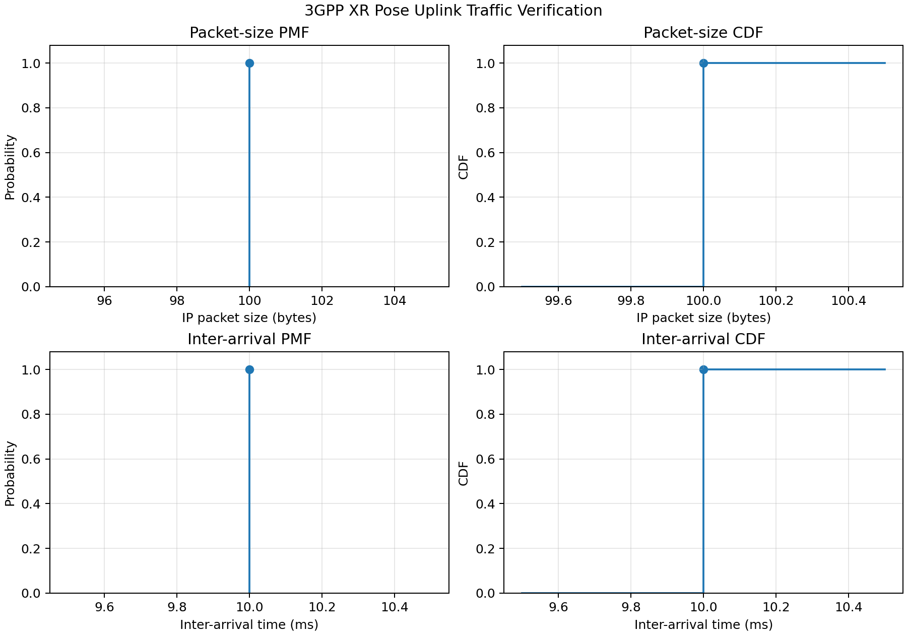
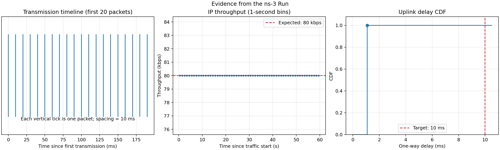

# A2 — ns-3 Setup & XR Pose Uplink Traffic Model

## 1. Environment and installation

This submission uses the environment below for the verified run.

| Item | Value |
|---|---|
| ns-3 | 3.44 (`ns-3.44`) |
| Operating system | Ubuntu 22.04.5 LTS, x86-64 |
| Kernel | Linux 6.8.0-138-generic |
| Python | 3.10.12 |
| System CMake | 3.22.1 |
| C++ compiler | GCC/G++ 10.5.0 |
| Build system | CMake + Ninja |
| Run verified on | 2026-10-12 (Asia/Taipei) |

The ns-3 source tree is located at `/home/karl/projects/ns-3-dev`. A
reproducible source installation and configuration sequence is:

```bash
git clone --branch ns-3.44 https://gitlab.com/nsnam/ns-3-dev.git ns-3-dev
cd ns-3-dev
./ns3 configure --enable-examples
./ns3 build
```

The A2 program itself only needs the ns-3 core, network, internet, mobility,
and point-to-point modules. Missing optional modules such as BRITE, Click,
OpenFlow, SQLite, and Python bindings do not affect this experiment.

### What broke and how it was handled

1. **`ccache` could not write its temporary/configuration files in the
   restricted execution environment.** The build reported errors under
   `/home/karl/.config/ccache` or `/run/user/1000/ccache-tmp`. The workaround
   was to disable `ccache` for the command:

   ```bash
   CCACHE_DISABLE=1 ./ns3 build xr-pose-uplink
   ```

2. **Matplotlib printed non-fatal Axes3D and Wayland warnings.** This A2 does
   not use 3-D plotting. The plotting script now explicitly selects the
   non-interactive `Agg` backend and suppresses only the irrelevant Axes3D
   warning. The PNG files are generated normally without opening a GUI.

3. **The newer ns-3.48 + 5G-LENA v5.1 installation-in-progress is kept
   separately at `/home/karl/projects/ns-3.48-nr`.** It is future work for
   NR/SRS experiments and is not used to claim the results in this report.
   Keeping both trees prevents API/dependency changes from breaking this
   verified ns-3.44 A2 baseline.

## 2. Scenario and traffic model

The model follows the pose sampling/reporting behavior in 3GPP TR 26.926,
clause 5.9.2. A stationary XR device is valid for traffic-model verification:
the position and orientation values remain fixed, while the pose is sampled
again every 1 ms and receives a new timestamp.

```text
XR device (10.1.1.1)                         Server (10.1.1.2)
fixed pose, UDP source  ── 10 Mbps, 1 ms ──> UDP pose sink
       1 kHz sampling       Point-to-Point       records Rx time
       100 Hz reporting
```

| Parameter | Setting |
|---|---:|
| Sender / receiver | 1 XR device / 1 server |
| Transport | UDP over IPv4 |
| Pose sample interval | 1 ms (1 kHz) |
| Report interval | 10 ms (100 Hz) |
| Report rule | Send the latest pose after the current sample |
| Position | `(1, 1, 1.2)` m, fixed |
| Orientation | Quaternion `(0, 0, 0, 1)`, fixed |
| Link | Point-to-Point, 10 Mbps |
| One-way propagation delay | 1 ms |
| Traffic duration | 60 s |
| Expected reports | 6,000 |
| Delay target | no greater than 10 ms |

UDP is used because pose updates are periodic, time-sensitive state updates.
If a report were lost, the next report would replace it 10 ms later; TCP
retransmission and head-of-line blocking could make an old pose arrive late.
The A2 baseline therefore measures the traffic model and link delay without
TCP connection control, acknowledgements, or retransmissions.

## 3. Pose packet format

The 60-byte pose encoding is an experiment choice; the traffic specification
does not prescribe this exact byte-level application encoding.

| Pose field | Encoding | Bytes |
|---|---|---:|
| Position `(x,y,z)` | 3 × `float32` | 12 |
| Quaternion `(qx,qy,qz,qw)` | 4 × `float32` | 16 |
| Sample timestamp | `uint64` | 8 |
| Device ID | `uint32` | 4 |
| Reserved/padding | 5 × `uint32` | 20 |
| **Pose subtotal** |  | **60** |

The transmitted packet is:

| Layer/field | Bytes |
|---|---:|
| Pose payload | 60 |
| Sequence number + send timestamp | 12 |
| UDP header | 8 |
| IPv4 header | 20 |
| **IPv4 packet total** | **100** |
| PPP header in the PCAP | +2 |
| **Captured Point-to-Point frame** | **102** |

Thus the expected IP-layer offered rate is
`100 bytes × 8 bits/byte × 100 packets/s = 80,000 bit/s`, or **80 kbps**.

## 4. Source code and reproduction

- Simulation source: [`scratch/xr-pose-uplink.cc`](scratch/xr-pose-uplink.cc)
- Plotting source: [`scratch/plot-xr-pose-results.py`](scratch/plot-xr-pose-results.py)
- Short model README: [`scratch/xr-pose-uplink-README.md`](scratch/xr-pose-uplink-README.md)

Run from the ns-3 root:

```bash
cd /home/karl/projects/ns-3-dev
CCACHE_DISABLE=1 ./ns3 build xr-pose-uplink
CCACHE_DISABLE=1 ./ns3 run xr-pose-uplink
python3 scratch/plot-xr-pose-results.py --prefix xr-pose-uplink
```

Optional command-line parameters include `--duration`, `--dataRate`,
`--channelDelay`, `--outputPrefix`, and `--enablePcap`. For example:

```bash
CCACHE_DISABLE=1 ./ns3 run \
  'xr-pose-uplink --duration=60 --dataRate=10Mbps --channelDelay=1ms'
```

## 5. Result from my own run

The verified 60-second run printed:

```text
Sent=6000 received=6000 loss=0%
Delay mean=1.0816 ms max=1.0816 ms <=10ms=100%
Pose age mean=1.0816 ms, IP offered rate=80000 bps
```

| Metric | Measured result |
|---|---:|
| Packets sent / received | 6,000 / 6,000 |
| Packet loss | 0% |
| Mean one-way delay | 1.0816 ms |
| Maximum one-way delay | 1.0816 ms |
| Reports meeting 10 ms target | 100% |
| Mean pose age at reception | 1.0816 ms |
| Mean transmission interval | 10.0000 ms |
| IP packet size | 100 bytes |
| IP offered traffic | 80,000 bit/s (80 kbps) |

The measured 1.0816 ms is explained by 1 ms propagation plus 81.6 µs of
serialization: `102 bytes × 8 / 10 Mbps = 81.6 µs`. The 102 bytes include the
100-byte IPv4 packet and the 2-byte PPP link header.

### Traffic-model PDF/PMF and CDF verification

This model is intentionally deterministic, so both distributions contain one
probability mass:

- Packet size: `P(X = 100 bytes) = 1`.
- Inter-arrival time: `P(T = 10 ms) = 1`.
- Their CDFs jump from 0 to 1 at 100 bytes and 10 ms, respectively.



The additional evidence plot shows the first 20 transmissions, throughput in
one-second bins, and the empirical delay CDF:



### Trace and PCAP evidence

- Machine-readable summary: [`xr-pose-uplink-summary.csv`](xr-pose-uplink-summary.csv)
- Per-packet trace (6,000 data rows):
  [`xr-pose-uplink-packets.csv`](xr-pose-uplink-packets.csv)
- Sender-side capture: [`xr-pose-uplink-0-0.pcap`](xr-pose-uplink-0-0.pcap)
- Receiver-side capture: [`xr-pose-uplink-1-0.pcap`](xr-pose-uplink-1-0.pcap)

Reading the sender capture gives:

```text
1.000000 IP 10.1.1.1.49153 > 10.1.1.2.5000: UDP, length 72
1.010000 IP 10.1.1.1.49153 > 10.1.1.2.5000: UDP, length 72
1.020000 IP 10.1.1.1.49153 > 10.1.1.2.5000: UDP, length 72
1.030000 IP 10.1.1.1.49153 > 10.1.1.2.5000: UDP, length 72
```

The timestamps differ by exactly 10 ms. Wireshark should decode each capture
as PPP → IPv4 → UDP, showing a 72-byte UDP payload, a 100-byte IPv4 packet,
and a 102-byte captured PPP frame.

## 6. Conclusion

The run proves that this ns-3 installation executes a custom XR scenario and
that the generated traffic matches the intended baseline: fixed 100-byte IP
packets every 10 ms for 60 seconds. All packets arrived, the offered rate was
80 kbps, and every packet met the 10 ms uplink-delay target. Mobility, NR radio
channels, SRS, and positioning error are deliberately left for later work so
that A2 isolates and verifies the traffic generator first.
