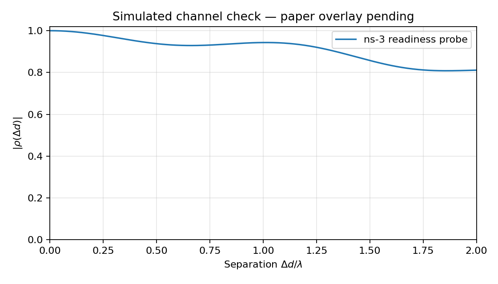

# ns-3.48 Environment and Channel Readiness

Date: 2026-11-09 (Asia/Taipei). This records simulator setup and a small readiness check, not a completed A4 paper reproduction.

## Separate Installations

| Role | Location | Version |
|---|---|---|
| Original A2 environment | `/home/karl/projects/ns-3-dev` | ns-3.44 |
| Uplink channel / future NR environment | `/home/karl/projects/ns-3.48-nr` | ns-3.48 |
| NR module | `/home/karl/projects/ns-3.48-nr/contrib/nr` | 5G-LENA v5.1 |

The upgrade completes the existing separate 3.48 tree. It does not replace the old 3.44 installation or alter the verified A2 results.

## Build Configuration and Fix

Compiler: `/usr/bin/g++-12`. Build generator: Ninja. CMake: bundled version 3.31.6 at `/home/karl/projects/ns-3.48-nr/.tools/cmake/data/bin/cmake`. Examples and tests enabled.

Source revisions checked locally:

- ns-3: `d2add90b452d600cfb4859baed8e9ea633519447` (`ns-3.48`).
- 5G-LENA: `cedceadda17392c90587fb9400eb9b1f8c236713` (`v5.1`).
- Compiler: GCC 12.3.0; assertions and logging enabled in the default build profile.

The first build failed because the cached `SQLite3_LIBRARY` selected a non-PIC static archive. Linking it into ns-3's shared stats library produced `R_X86_64_PC32 ... recompile with -fPIC`. The installed shared runtime library fixes this without installing a new system package:

```bash
/home/karl/projects/ns-3.48-nr/.tools/cmake/data/bin/cmake \
  -S /home/karl/projects/ns-3.48-nr \
  -B /home/karl/projects/ns-3.48-nr/cmake-cache \
  -DSQLite3_LIBRARY=/usr/lib/x86_64-linux-gnu/libsqlite3.so.0

env CCACHE_DISABLE=1 \
  /home/karl/projects/ns-3.48-nr/.tools/cmake/data/bin/cmake \
  --build /home/karl/projects/ns-3.48-nr/cmake-cache --parallel 4
```

Optional integrations such as BRITE, Click, MPI, OpenFlow, Python bindings and Sionna are not needed for this C++ channel probe. Python post-processing of exported data does not require ns-3 Python bindings.

For later use of the `ns3` wrapper, put the bundled CMake **binary** directory first for that command; the system CMake is older. This does not change global shell configuration:

```bash
cd /home/karl/projects/ns-3.48-nr
env PATH="/home/karl/projects/ns-3.48-nr/.tools/cmake/data/bin:$PATH" \
  CCACHE_DISABLE=1 python3 ns3 run cttc-nr-demo --no-build
```

## Readiness Probe

Source: [channel-spatial-probe.cc](src/channel-spatial-probe.cc). Runner: [run-channel-probe.sh](src/run-channel-probe.sh). Validation: [check-channel-probe.py](src/check-channel-probe.py).

The runner compiles the repository's source into a temporary directory and links it against the built 3.48 libraries. It does not copy source into the external ns-3 checkout. It writes correlation CSV, a small complex-channel witness CSV, and a plot under the specified output directory.

From the course repository root:

```bash
bash A3/src/run-channel-probe.sh A3/results/los --run=1
bash A3/src/run-channel-probe.sh A3/results/nlos --run=1 --nlos=1
bash A3/src/run-channel-probe.sh /tmp/a3-los-repeat --run=1
cmp A3/results/los/correlation.csv /tmp/a3-los-repeat/correlation.csv
cmp A3/results/los/correlation.csv.witness.csv /tmp/a3-los-repeat/correlation.csv.witness.csv
```

Default configuration: seed 20261109; run 1; channel stream 1; 3.7 GHz; `InH-OfficeMixed`; 4 × 25 BS array; one UE element; 100 frequency points; 180 kHz spacing; UE speed 0.1 m/s; 1 mm sampling displacement; 257 samples / 2.56 s; correlation evaluated up to 2 wavelengths.

Project geometry: BS `(0,0,2.5)` m; UE starts `(2,2,1.73)` m, moving in +x. BS elements use the 3GPP antenna pattern and the UE element is isotropic. These are declared surrogate choices, not the paper's complete measured geometry.

### What the Export Means

- `GetChannel()` returns complex cluster-domain antenna coefficients, not a ready-to-export 100-tone CSI matrix.
- The probe combines these coefficients with cluster delays and the cluster-centre Doppler convention used by `ThreeGppSpectrumPropagationLossModel` to form `H(antenna,frequency,time)`.
- At the beginning, midpoint and endpoint, the exported response is compared against ns-3's own spectrum-channel conversion with relative tolerance `1e-9 * max(1, |H|)`. For that check, one mathematical receive port is assigned to each array element with unity weights. This is a channel-export arrangement, not 100 standardized NR SRS ports.
- This check uses normalized small-scale coefficients. It does not include explicit path-loss scaling, RF-chain impairments, additive receiver noise, NR SRS estimation errors, MAC scheduling or packet traffic.
- It uses the same UE/BS link throughout the trajectory and enables nonzero channel updates. Creating a new independent link at every position would not be a valid spatial-map construction.
- Per-pair normalization precedes averaging, and magnitude is taken after averaging complex correlations.

### Checks and Their Limits

Required checks: correct antenna dimensions; finite, nonzero complex response; changing coefficients and channel generation timestamps along a moving path; `rho(0)=1`; `|rho|<=1`; lags near 2λ; identical CSVs for a repeated seed/run; different output when run is changed.

These are execution/numerical checks. They do not prove that the resulting correlation curve matches the measurement, that the channel model's spatial behavior is sufficiently accurate, or that a two-dimensional map is independent of scan-path history. Those are subsequent experiment checks.

### Delay-Factor Cache Detail Found During Verification

The unrefreshed spectrum cross-check initially failed at the moving-path midpoint. In this checkout, `UpdateChannelParameters()` changes cluster delays in place, but `GenSpectrumChannelMatrix()` only checks the band count, cluster count and cached bandwidth before reusing frequency-delay factors. The probe invalidates `m_cachedRbWidth` before each of its three spectrum cross-checks, forcing the factors to be recalculated. All three comparisons then pass.

The primary exporter computes its frequency-delay factors directly for every snapshot and therefore does not reuse that stale cache. No ns-3 library source was modified. Future experiments using the spectrum model directly with moving channels should address this cache behavior explicitly; the existing official test suite alone did not catch it in this configuration.

## Verification Record

The following were executed locally; these are not published-paper results:

| Check | Observed result |
|---|---|
| Full configured build | Completed successfully, exit 0, all 2,390 scheduled build steps including NR, examples and tests |
| `ns3 run 'cttc-nr-demo --PrintHelp' --no-build` | Exit 0 through the normal wrapper with the bundled CMake binary on PATH |
| Official `three-gpp-channel`, QUICK | PASS, including LOS/NLOS consistency cases, channel matrices, updates and spectrum/MIMO checks |
| Official `nr-realistic-beamforming-test`, QUICK | PASS, basic case and beam-match versus SRS SINR |
| `cttc-nr-demo`, 1 gNB / 2 UEs / 600 ms / single operational band | Exit 0; each UDP flow sent 2,000 packets and received 1,997 before the stop time |
| LOS readiness probe | 257 snapshots, 100 receive elements × 100 tones, 256 generation changes, 3 spectrum cross-checks; validation PASS |
| NLOS readiness probe | Same dimensions; validation and 3 spectrum cross-checks PASS |
| Same seed/run repeated | Correlation CSV and witness CSV are byte-identical (`cmp` exit 0) |
| Different run | Run 2 produces a different CSV hash, as expected |
| Probe C++/Python/shell checks | C++ compiles; Python parses; shell syntax and repository diff checks pass |

The suite checks above initially used the unchanged upstream `utils/test-runner.cc`, compiled in `/tmp` and linked to the newly built spectrum/NR test libraries while the remaining examples were still building. They were then checked with the standard runner after the full build. Commands:

```bash
/home/karl/projects/ns-3.48-nr/build/utils/ns3.48-test-runner-default \
  --suite=three-gpp-channel --fullness=QUICK --verbose
/home/karl/projects/ns-3.48-nr/build/utils/ns3.48-test-runner-default \
  --suite=nr-realistic-beamforming-test --fullness=QUICK --verbose
```

NR smoke-test command (output files were placed in `/tmp/a3-nr-upgrade-demo`):

```bash
mkdir -p /tmp/a3-nr-upgrade-demo
/home/karl/projects/ns-3.48-nr/build/contrib/nr/examples/ns3.48-cttc-nr-demo-default \
  --gNbNum=1 --ueNumPergNb=2 --doubleOperationalBand=0 --simTime=600ms \
  --outputDir=/tmp/a3-nr-upgrade-demo --simTag=upgrade-check
```

The 2.56-second readiness curves reach `|rho|=0.811155` (LOS) and `0.152320` (NLOS) at the last sampled lag, `1.998λ`, for seed 20261109/run 1. These are checks of two chosen surrogate channels, not an estimate of the paper's curve or proof of agreement. The LOS curve remains strongly correlated; this is a behavior to analyze against the original measurement rather than silently tune away.

- [LOS CSV](results/los/correlation.csv), [complex-channel witness](results/los/correlation.csv.witness.csv), [plot](results/los/correlation.png).
- [NLOS CSV](results/nlos/correlation.csv), [complex-channel witness](results/nlos/correlation.csv.witness.csv), [plot](results/nlos/correlation.png).



### Reproducibility Hashes

LOS run 1 correlation CSV: `849d8165bf134284eaa6ff2b754c82e32c13c458968f7e8273eecd04ec9c8726`.

LOS run 2 correlation CSV: `3459f34d959ae76b599cec99793bc05cca60bb006b29b0d0b8192c2319cc0d37`.

## A4 Work Remaining

Read/digitize Fig. 7 with verified axes, compare against the planned 42-second trajectory over multiple runs, record all assumptions, and explain differences from the measured studio. The readiness plot must not be submitted as if it already includes the published reference curve.
