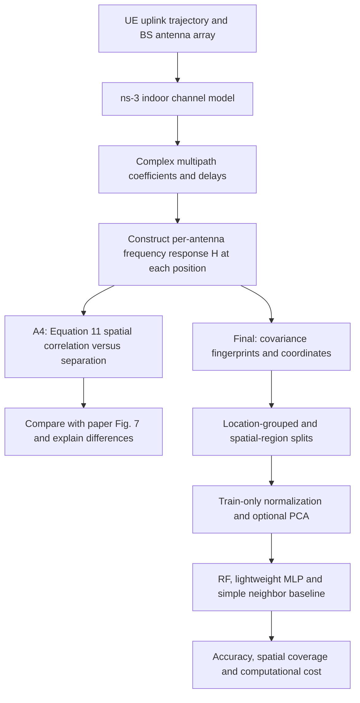

# A3 — Literature Review: Uplink Channel Fingerprinting and Spatial Generalization

Student: M11502203 Ping-Yu Hsieh / 謝秉祐  
Updated: 2026-11-09 (Asia/Taipei)  
Current proposal: [A3/proposal.md](proposal.md)

## 1. Selected Paper and Reading Scope

G. Tian, I. Yaman, M. Sandra, X. Cai, L. Liu, and F. Tufvesson, **“Deep-Learning-Based High-Precision Localization With Massive MIMO,”** *IEEE Transactions on Machine Learning in Communications and Networking*, vol. 2, pp. 19–33, 2024. DOI: [10.1109/TMLCN.2023.3334712](https://doi.org/10.1109/TMLCN.2023.3334712).

- [Publisher DOI](https://doi.org/10.1109/TMLCN.2023.3334712)
- [University-hosted PDF](https://portal.research.lu.se/files/165039395/TMLCN.pdf)
- [Readable author full text](https://www.researchgate.net/publication/376014600_Deep-learning_based_high-precision_localization_with_massive_MIMO)

This assignment selects **one** IEEE Transactions paper, within the course's 1–3-paper requirement. Section and figure references below refer to this paper. The source is the authors' full article, especially Sections II–V, not only its abstract. The online publication date is in 2023; the volume citation is 2024.

The paper explicitly studies **uplink**: a single-antenna UE sends pilots and a multi-antenna base station measures the channel. Its measurement configuration is LTE-like OFDM; it is **not a demonstrated NR-SRS positioning implementation**. The project retains the uplink localization question from A1 while moving the primary experiment to simulated channel fingerprints.

## 2. Problem, Importance, and Challenges

### 2.1 Problem

The paper estimates indoor UE coordinates from uplink channel fingerprints. It investigates feature choice, model size, uncertainty estimation, and spatial sampling density. Its processing chains learn from covariance/CIR features and combine position estimates; the subarray approach reduces the size of individual networks.

For this project, the question motivated by that work is:

> When nearby channel samples are correlated, does an RF-versus-MLP comparison still show useful localization performance after complete spatial locations or regions are excluded from training?

This is our extension, not a claim that the paper already performs our spatial-region holdout experiment.

### 2.2 Importance

Reliable indoor location estimates support mobile robots and location-based services. A practical project must also account for data-collection cost and computational cost. A simulation-based study allows controlled changes to spatial sample spacing, multipath, and training coverage without operating a live radio testbed.

The paper's discussion of training density makes the A1 concern about correlated frames concrete: effective spatial information depends on where measurements are taken, not just how many frames exist.

### 2.3 Challenges

| Challenge | What must be handled in this project |
|---|---|
| Multipath and small-scale channel variation | Preserve complex channel information and inspect variation along a continuous UE path. |
| Large antenna-by-frequency input | Use an explicitly defined covariance representation; fit dimensionality reduction only on training data. |
| Spatial sampling and coverage | Separate sampling interval from train/test partition choice. |
| Location leakage | Keep every snapshot of a coordinate in one partition; prevent neighborhood averaging across train/test boundaries. |
| Simulation-to-measurement mismatch | Compare the same observable with the paper and report assumptions rather than promising identical curves. |
| Model complexity | Report model size and inference latency with accuracy. |

## 3. System Model

### 3.1 Environment and Signal Model in the Paper

The main experiment uses a static indoor motion-capture studio with a robot-mounted UE and a massive-MIMO BS. The robot moves while the surrounding objects remain stationary. The received channel representation is

\[
\mathbf Y_{\mathbf p}=\mathbf H_{\mathbf p}\odot\boldsymbol\Gamma+\mathbf N,
\]

where the terms represent the propagation channel, RF-chain effects, and receiver noise. The UE position is \(\mathbf p=(x,y)\). See Section II, Equation (1).

The covariance fingerprint is formed from antenna-domain outer products of frequency samples, optionally averaged over a spatial neighborhood. CIR features represent delay-domain information. **Spatial covariance across antennas is different from spatial correlation across UE positions**: the first is a localization feature, while the second is the A4 channel observable.

### 3.2 Inputs, Outputs, and Metrics

| Item | Paper | Our planned use |
|---|---|---|
| Inputs | Uplink channel snapshots, position labels, covariance/CIR features | Simulated complex channel snapshots, known UE coordinates, then covariance-based fingerprints |
| Model output | 2-D position and estimated uncertainty | RF/MLP coordinates; uncertainty learning is outside the initial implementation |
| Position metric | Positioning-error distributions | Euclidean-error CDF, mean, median, RMSE, P90, percentages within 0.5/1 m |
| Uncertainty metric | Negative log-likelihood | Discussed in A3; not claimed to be reproduced by coordinate-only RF/MLP |
| Channel observable | Empirical spatial correlation, Equation (11), Fig. 7 | Primary A4 result to reconstruct with ns-3 |
| Cost | Model/computation considerations | Training time, serialized size, CPU inference latency |

Our localization RMSE will be defined explicitly as \(\sqrt{T^{-1}\sum_i\|\hat{\mathbf p}_i-\mathbf p_i\|_2^2}\). Do not import the \(1/(2T)\) convention from the other covariance paper discussed during topic selection.

### 3.3 Simulation-to-Analysis Pipeline

The simulation models a UE-to-BS channel. Extracting ideal channel coefficients is not the same as transmitting and estimating an actual NR SRS waveform. The latter would be a separate extension.

## 4. Experimental Results and Original Settings

### 4.1 Results Relevant to This Project

The paper reports centimeter-level accuracy in its particular indoor measurement campaign, improvements from feature processing and subarrays, and degradation with insufficient spatial training density. Fig. 7 and Equation (11) quantify correlation along a UE trajectory. Figs. 8, 14, and 17 examine feature/training-density choices, added noise, and training-sample selection, respectively. These are measured-data findings, not results already obtained by this project. [Source: Sections IV–V of the author full text](https://www.researchgate.net/publication/376014600_Deep-learning_based_high-precision_localization_with_massive_MIMO).

For the selected A4 observable, Section IV-B describes strong correlation for separations up to about λ/8 and decreasing correlation at larger separations. This is an observed property of that measurement, not a universal indoor-channel threshold. Our readiness LOS surrogate remains highly correlated out to 2λ; that discrepancy is already a reason to investigate the channel assumptions before claiming agreement.

### 4.2 Original Experiment: Reproduction-Setting Checklist

| Required field | What the paper reports | Source / qualification |
|---|---|---|
| Topology | One measured UE and one BS array; main scan area 4.2 × 2.5 m² | Section IV-A, Figs. 4–5; exact geometry needs inspection of Fig. 5 and cited measurement material |
| Carrier / nominal bandwidth | 3.7 GHz / 20 MHz | Section IV-A |
| Antennas | UE dipole at 1.73 m; 100 BS patch elements arranged 4 × 25, about half-wavelength spacing | Section IV-A |
| Pilot allocation | 100 sampled tones per UE, every twelfth subcarrier in an LTE-like 100-PRB configuration | Section IV-A; not a claim of NR-SRS configuration |
| Motion / recording | 0.1 m/s, snapshots every 10 ms | Section IV-A; approximately 1 mm along-track sample spacing |
| Dataset size | 75 trajectories; 302,500 channel snapshots | Section IV-A; do not infer exact trajectory endpoints from counts alone |
| Traffic model | Periodic uplink pilot measurements | No UDP/TCP application workload specified for this channel/localization experiment |
| PHY/MAC details | Pilot/channel measurement setup described above | TX power, BS height/bearing, scheduler, MCS and HARQ are not established by the reviewed setup text; do not fabricate them |
| Simulation time | Main experiment is a measurement campaign | No original ns-3 duration; 4.2 m / 0.1 m/s = 42 s is a derived single-path estimate, not the reported campaign duration |
| Seeds / runs | No simulation seed list established from the reviewed text | Measurement trajectories are not independent simulator RNG runs; our RNG policy is specified separately |

The apparent full-band grid and the 100 observed pilot tones must not be confused. For our frequency-response probe, 180 kHz tone spacing is an **LTE-grid interpretation** (12 × 15 kHz), not an independently verified SRS setting.

### 4.3 A4 Target: Fig. 7

Chosen result: **empirical spatial correlation along one UE trajectory**.

Flatten the channel across antenna and sampled frequency into \(\mathbf h_i\). For lag \(k\), use the valid position pairs:

\[
\rho_k=\frac{1}{N-k}\sum_{i=0}^{N-k-1}
\frac{\mathbf h_i^H\mathbf h_{i+k}}
{\|\mathbf h_i\|_2\|\mathbf h_{i+k}\|_2}.
\]

Plot \(|\rho_k|\) against displacement, expressing distance in wavelengths over 0–2λ as in Fig. 7. **Average complex correlations first and then take the magnitude**; averaging pairwise magnitudes is a different statistic. Check the final figure's tick labels before creating the submitted overlay.

Why this result: it tests the channel structure needed for spatial fingerprint learning and can be reconstructed without reproducing all neural networks. It establishes a channel baseline; it does **not** establish a localization-accuracy baseline by itself.

### 4.4 Our Proposed ns-3 Settings — Not Original Paper Parameters

| Parameter | Planned A4 configuration |
|---|---|
| Platform | ns-3.48 with 5G-LENA v5.1 available; initial probe uses core channel/mobility/antenna modules directly |
| Direction | One single-element UE transmitter; one multi-element BS receiver |
| Channel | `ThreeGppChannelModel`, `InH-OfficeMixed`, forced LOS for the primary curve; NLOS as sensitivity study |
| Frequency / array | 3.7 GHz; BS 4 × 25 elements at 0.5λ spacing; single polarization |
| Antenna element | 3GPP BS element pattern; isotropic UE approximation to the paper's dipole |
| Coordinates | Project assumption: BS (0, 0, 2.5 m); UE starts (2, 2, 1.73 m), moves in +x |
| Pilot-tone surrogate | 100 frequency samples spaced 180 kHz; frequency-response sampling, not waveform decoding |
| Speed / sampling | 0.1 m/s / 10 ms; displacement 1 mm |
| Duration | Full planned single path: 42 s and 4,201 endpoint-inclusive samples; readiness check is shorter |
| Channel update | Nonzero spatial-consistency update period; evaluate with displacements below the implementation's 1 m limit |
| RNG | `SetSeed(20261109)`, `SetRun(1..10)`, channel `AssignStreams(1)` |
| Repeated runs | 10 independent channel RNG runs; retain the single-run curves and average curve |
| Traffic / MAC | No application packets or scheduler in the channel-only probe; state N/A rather than inserting an unrelated UDP model |
| Noise | Initial probe uses ideal normalized small-scale channel coefficients; any noise experiment needs a separate documented SNR rule and RNG |

The minimal readiness program is [src/channel-spatial-probe.cc](src/channel-spatial-probe.cc); [src/check-channel-probe.py](src/check-channel-probe.py) checks its numerical invariants. Build/verification evidence is recorded in [environment.md](environment.md). These checks are not a completed reproduction of Fig. 7.

### 4.5 What Is Needed Before A4 Can Be Submitted?

1. Verify the moving-link channel path, including delay/frequency conversion and Doppler, against ns-3's own convention.
2. Run the planned path and seeds; retain configurations and output files.
3. Obtain Fig. 7 as a readable image/PDF, verify axes, and digitize its curve if numerical data is unavailable. Label digitization error and never invent reference points.
4. Overlay the ns-3 curve with the published curve; compare small-lag behavior, decay and oscillations without tuning on the reference curve silently.
5. Explain discrepancies: statistical Office model versus the measured studio, array pattern/bearing, noise and RF-chain effects, and scatterer/spatial-consistency differences.

The two-dimensional map also needs cross-path consistency. Continuity along one moving UE link does not prove that separately initialized scan lines belong to a single consistent radio map. Final-project data generation must pass this check before interpreting location-regression scores.

## 5. Revision of the A1 Project Proposal

The original proposal is preserved in [A1/proposal.md](../A1/proposal.md); the active revision is [A3/proposal.md](proposal.md).

| Original A1 | Revised proposal | What changed and why |
|---|---|---|
| Required the original measured 32-D SRS dataset | Primary experiment uses simulated uplink channel fingerprints | Enables an all-simulation workflow and a channel result that can be reconstructed in ns-3. |
| Paper baseline was an unpublished OAI manuscript | Published Tian et al. article is the A3/A4 reference | Provides an accessible Transactions article and a specific published observable. |
| RF → lightweight MLP | Retain RF/MLP; add a neighbor baseline if feasible | Preserves the research question while checking whether any model gain exceeds a simple fingerprint method. |
| Fixed processed SRS feature semantics | Define covariance features and optional train-only PCA to 32 components | The simulated input is not the original 16+8+8 SRS vector; names and feature dimensions must remain honest. |
| No feature extraction work | Add channel extraction, correlation checks and feature generation | Simulation-generated fingerprints require explicit verification before training. |
| Random, grouped and spatial splits | Retain these; add sampling-density and spatial-buffer controls | These splits were already in A1. The new addition is testing how channel correlation and coverage affect them. |
| Compare directly to reference RF errors | Compare models on the same new simulated partitions | The old manuscript's numerical errors are not targets for a different dataset/channel model. |

### Revised Research Question

> In a controlled simulated indoor uplink channel, how do spatial sampling and train/test separation affect fingerprint-localization accuracy, and can a lightweight MLP improve on RF at unseen locations under the same inputs and partitions?

### Revised Experimental Sequence

1. **A3:** Review the published uplink model and its evidence on feature design and spatial sampling.
2. **A4:** Reconstruct the Fig. 7 channel observable in ns-3 and explain measurement-to-simulation differences.
3. **Final baseline:** Generate a verified radio map; evaluate a simple fingerprint/neighbor method and RF.
4. **Final modification:** Evaluate the lightweight MLP, spatial holdouts, sampling-density sensitivity and CPU cost.

An MLP improvement is a hypothesis, not a promised result. A poor match to Fig. 7 or a negative localization result is useful only when the parameter choices and model limitations are explained.

### Scope and Limitations

- The primary workflow is entirely simulated; no RU, OAI, E2 interface or xApp is required.
- Standardized NR SRS transmission/estimation is not claimed by channel-coefficient extraction.
- A statistical indoor model does not recreate the actual studio geometry or establish real-world centimeter accuracy.
- The A4 channel curve supports the final study but does not replace an RF/neighbor localization baseline.
- Cross-room/device/day generalization and operational real-time performance remain outside scope.

## References

1. G. Tian et al., “Deep-Learning-Based High-Precision Localization With Massive MIMO,” *IEEE TMLCN*, vol. 2, pp. 19–33, 2024. [DOI](https://doi.org/10.1109/TMLCN.2023.3334712). Sources for paper statements: Sections II, III, IV-A/B, V-A/F; Figs. 7, 8, 14 and 17.
2. ns-3.48 local source: `src/spectrum/model/three-gpp-channel-model.{h,cc}`, `three-gpp-spectrum-propagation-loss-model.cc`, and `src/spectrum/test/three-gpp-channel-test-suite.cc`. These establish local implementation behavior, not the original paper's configuration.
3. P.-Y. Hsieh et al., “Uplink SRS-Based Real-Time Indoor Localization System over OpenAirInterface,” manuscript, 2026, as listed in the original A1 proposal. Historical motivation; not treated here as an independently verified published benchmark.
