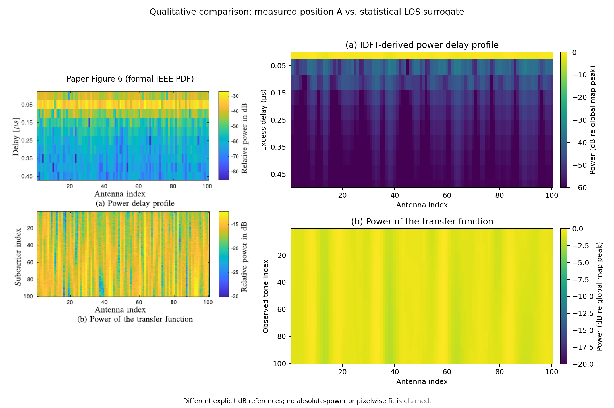
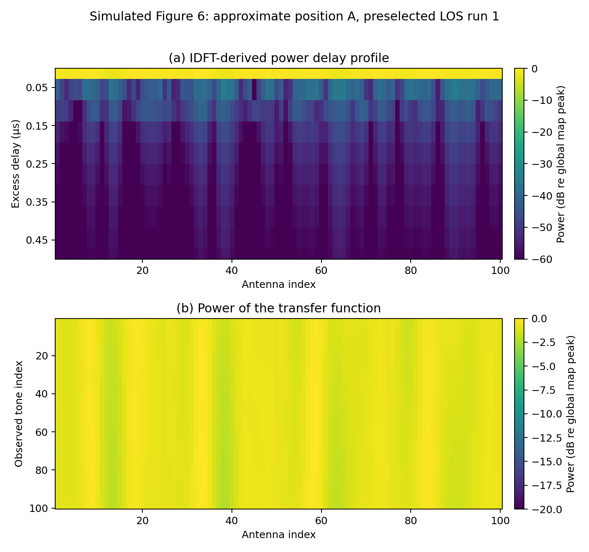
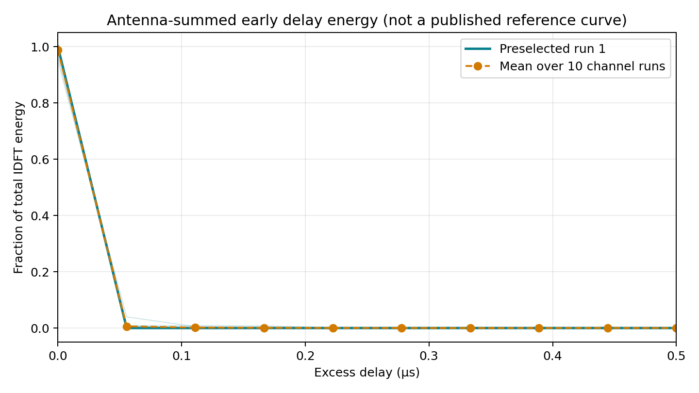

# A4 Addition: Figure 6 Channel-Power Heatmaps

Student: M11502203 Ping-Yu Hsieh

Date: 2026-11-23 (Asia/Taipei)

## 1. Selected Result

Figure 6 shows (a) the power delay profile and (b) transfer-function power across 100 BS antennas at measurement position A. The paper describes concentration in early delay bins and smoother frequency variation than antenna-to-antenna variation. This addition reconstructs those observables with the ns-3 channel, complementing the main Figure 7 experiment. It does not reproduce the original room or its measured complex coefficients. [1]



The left image is cropped from the formal IEEE PDF supplied by the user, PDF page 7 / printed page 25. The right uses **preselected run 1**, not a visually selected realization. Source hash, crop command and position-A calibration are recorded in [figure6-provenance.json](reference/figure6-provenance.json). Unlike the earlier Figure 7 numerical extraction, this reference comes directly from the formal PDF. No numerical heatmap values were invented or extracted by treating image colors as calibrated measurements.

## 2. Geometry and ns-3 Settings

Position A has no surveyed coordinates in the reviewed description. We estimate its location using proportions in the embedded Figure 5 drawing: scan bounds x = 242–722 and y = 122–483 pixels, point-A center approximately (481,269), and region dimensions 4.2 × 2.5 m. This places A approximately (2.091,1.018) m inside the scan region. Adding the previously declared assumed region origin (1.1,−0.6) m gives (3.191,0.418) m, rounded to (3.19,0.42) m. These digits describe the calculation, not survey accuracy.

| Parameter | Setting |
|---|---|
| UE / BS | UE (3.19,0.42,1.73) m; BS (0,0,2.5) m |
| Geometry limits | Schematic A estimate; BS phase-center placement and height remain assumptions |
| Channel | ns-3.48 `ThreeGppChannelModel`, `InH-OfficeMixed`, forced LOS |
| Carrier / observed tones | 3.7 GHz; 100 tones, 180 kHz spacing, 17.82 MHz center-to-center span |
| Antennas | UE isotropic single element; BS 4 × 25, half-wavelength spacing, 3GPP element pattern |
| Array orientation | Bearing 0, downtilt 0; no retuning from the sensitivity results |
| RNG | Seed 20261109; runs 1–10; channel stream start 1 |
| Observation | One stationary channel snapshot per run at t = 0; no 42-second trajectory |
| Traffic / MAC | Not applicable; no packet workload, scheduler or SRS waveform estimation |
| Noise / RF effects | Not modelled; no selected best-SNR condition was added |
| Repeat control | Run 1 repeated with identical channel and cluster CSVs |

Both endpoints are stationary. The simulator generates each channel realization at t = 0, so this is not ten time samples of the same moving channel. The software revision, compiler and executed build command are recorded in [configuration.json](results/figure6/configuration.json). No previous exporter or result files were modified.

## 3. Signal Processing and dB Convention

The exporter stores the full unnormalized complex matrix H (100 antennas × 100 observed tones), cluster coefficients and excess delays. It reconstructs the frequency response from those coefficients/delays and checks all antenna/tone entries against ns-3's spectrum conversion before any plotting normalization.

For each antenna a:

\[
g_a[n]=\frac{1}{100}\sum_{k=0}^{99}H_a[k]e^{j2\pi kn/100},\qquad
P_{\mathrm{delay}}[a,n]=|g_a[n]|^2,\quad
P_{\mathrm{frequency}}[a,k]=|H_a[k]|^2.
\]

The 180 kHz observed-tone spacing gives native delay-bin spacing **55.56 ns**, and a periodic/unambiguous delay interval of **5.556 μs**. We do not relabel these as 50 ns bins based only on the nominal 20 MHz system bandwidth. The main PDP display covers approximately 0–0.5 μs, using the first ten native bins; full 100-bin output is retained. These are model excess-delay coordinates, not calibrated absolute time of arrival.

Each heatmap uses one scalar reference: `10 log10(power / global maximum power in that map)`. It does **not** normalize each antenna separately. The original paper uses relative-power dB displays and describes dataset-level normalization, but its complete measured tensor and RF calibration are unavailable here; that scale cannot be recreated from a single simulated snapshot. Accordingly, numeric dB values and colors are not claimed to match the original. The two simulated maps also have separate peak references, so colors must not be used to compare absolute power between panels.

The standard display clips color scales below −60 dB for PDP and −20 dB for transfer-function power. The raw CSVs are not clipped. A supplementary [native-range display](results/figure6/figure6-native-range.png) expands only the frequency color scale to its actual data range, clearly labelled; it does not alter any data. Rectangular-band IDFT sidelobes can wrap near the end of the delay period, so late IDFT-bin energy is not automatically evidence of a physical long-delay path.

## 4. Results and Differences



| Observable | Preselected run 1 | Across ten channel runs |
|---|---:|---:|
| Energy in first three IDFT bins, n = 0,1,2 | 99.9873% | Mean 99.6435%; range 98.2922–99.9998% |
| Energy through 0.5 μs | 99.9897% | Mean 99.8340% |
| Frequency-index power roughness | 0.000742 | Mean 0.010283 |
| Antenna-index power roughness | 0.041284 | Mean 0.209314 |
| Transfer-power dynamic range | 2.2182 dB | Range 0.7669–20.5674 dB |

Roughness is mean absolute adjacent-entry power difference divided by overall mean power, along the indicated displayed index. It is a project diagnostic, not a metric reported by the paper. Antenna index follows the simulator's array-element ordering; adjacent indices are not guaranteed to represent the same physical separation at array-row boundaries. In all ten runs antenna-index roughness exceeds frequency roughness. This supports a qualitative comparison of the plotted patterns, not an antenna-correlation measurement.

The simulated channel concentrates energy in early bins and shows smoother frequency than antenna-index variation. However, run 1 is much smoother and has weaker power contrast than the original image. The actual paper's deep antenna-dependent dips, delay-bin distribution and color levels are not reproduced. Unknown measured geometry, scatterers, antenna ordering, noise and RF-chain effects remain differences; the experiment does not isolate their individual contributions.



This supplemental curve sums power over antennas and divides by total IDFT energy, including bins outside the displayed first 0.5 μs. Thin curves show every realization, the solid curve is run 1, and the dashed curve is the ten-run mean. It is not an additional published-paper result. No pixelwise RMSE is reported because position A, antenna mapping and dB references are not matched sufficiently to justify it.

Data: [per-run metrics](results/figure6/metrics.csv), [summary](results/figure6/summary.json), [raw complex H for run 1](results/figure6/run-01/channel.csv), [raw clusters/delays](results/figure6/run-01/channel.csv.clusters.csv), [run-1 complex CIR](results/figure6/run-01/cir.csv), [all execution records](results/figure6/executions.json).

## 5. Verification and Reproduce

[Validation evidence](results/figure6/validation.json):

- Ten channel realizations, each with 10,000 finite complex entries; all ten channel hashes differ.
- Eleven complete spectrum-conversion checks, including the repeated run; all passed.
- Exact repeated run-1 channel and cluster CSVs.
- Independent reconstruction from exported cluster coefficients and delays: maximum difference zero in this execution.
- FFT/IDFT round-trip maximum error 1.84 × 10⁻¹⁵ or lower.
- Parseval relative energy error 2.77 × 10⁻¹⁶ or lower.

```bash
python3 A4/src/run-figure6.py
python3 A4/src/extract-figure6-reference.py /path/to/Deep-Learning-Based_High-Precision_Localization_With_Massive_MIMO.pdf
python3 A4/src/analyze-figure6.py
```

The exporter is [figure6-channel.cc](src/figure6-channel.cc); the runner records build/configuration details. Python analysis requires NumPy and Matplotlib; source-image extraction uses Poppler. The source PDF is not redistributed. Existing output paths are overwritten on rerun; choose another `--output` for simulation archival, noting the submitted analyzer reads `results/figure6` by default.

This is a second observable reconstructed with a statistical-channel surrogate, not a claim of exact Figure 6 numerical replication or real-world positioning accuracy. The original Figure 7 and all sensitivity studies remain available unchanged.

## References

[1] G. Tian et al., “Deep-Learning-Based High-Precision Localization With Massive MIMO,” IEEE TMLCN, vol. 2, pp. 19–33, 2024, doi: [10.1109/TMLCN.2023.3334712](https://doi.org/10.1109/TMLCN.2023.3334712), Section II-B and Section IV-B, Figures 5–6. Formal PDF supplied by the user; SHA-256 `9ff11015c1650b6d985911fa73b9c440c32dfa1a712072a3603bf628ac43baa2`.
