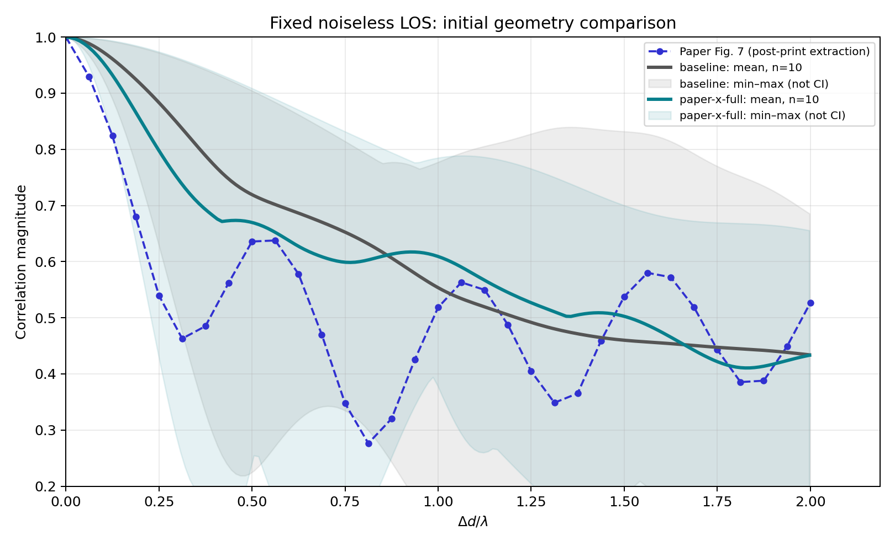
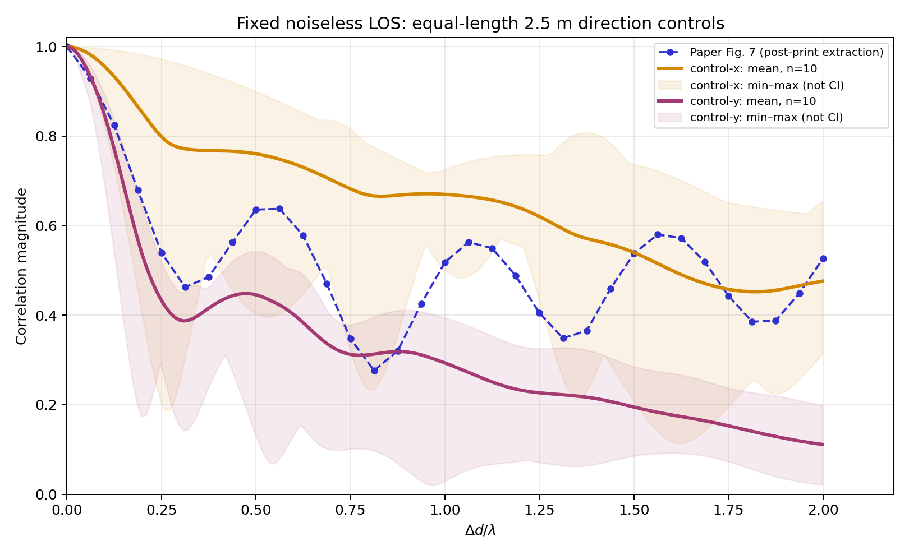
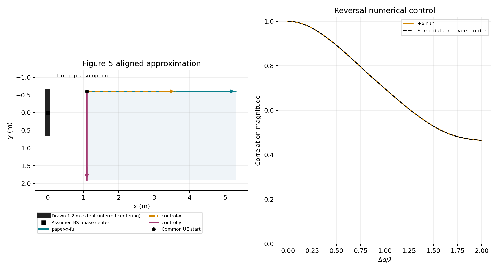

# A4 Follow-up: UE Trajectory and Direction

Student: M11502203 Ping-Yu Hsieh

Updated: 2026-11-22 (Asia/Taipei)

## 1. Question and Approved Geometry

Does aligning the simulated first trajectory with Figure 5 change the spatial correlation, and does changing path orientation relative to the BS affect the result? Figure 7 uses one UE trajectory, so this experiment does not reconstruct the complete serpentine scan. [1]

The approved approximate geometry places the BS at (0,0,2.5) m and the UE initially at (1.1,−0.6,1.73) m. The 1.1 m gap is taken from the drawing, while identifying the drawn face with the phase-center plane is an assumption. The −0.6 m offset assumes the phase center lies at the midpoint of the drawn 1.2 m LuMaMi extent and that the first line aligns with its upper edge. BS height 2.5 m remains an assumption. The figure's 1.2 m dimension is not a mounting height.

Original source crop: [Figure 5](reference/figure5-source.png); background interpretation: [geometry review](noise_study.md#3-geometry-review-what-figure-5-actually-shows).

| Profile | UE start (m) | Velocity (m/s) | Length / samples / duration | Role |
|---|---|---|---|---|
| Existing baseline | (2,2,1.73) | (0.1,0,0) | 4.2 m / 4,201 / 42 s | Existing data reused |
| `paper-x-full` | (1.1,−0.6,1.73) | (0.1,0,0) | 4.2 m / 4,201 / 42 s | Figure-5-aligned approximation |
| `control-x` | Same | (0.1,0,0) | 2.5 m / 2,501 / 25 s | Equal-length longitudinal control |
| `control-y` | Same | (0,0.1,0) | 2.5 m / 2,501 / 25 s | Counterfactual transverse control, not a reported paper trajectory |

All new profiles use noiseless LOS, `InH-OfficeMixed`, 3.7 GHz, 4 × 25 BS elements with half-wavelength spacing, 100 tones separated by 180 kHz, and 10 ms snapshot intervals. Channel seed is 20261109, runs are 1–10, stream start is 1. BS array bearing and downtilt remain zero. No SNR or channel-family change accompanies the geometry change.

The two direction controls have the same start, distance, duration and run IDs. After the initial point their locations differ, so this tests changing path orientation and the resulting spatial/angular evolution, not velocity direction at identical positions. The old baseline and `paper-x-full` both move +x; their comparison tests initial geometry, not movement direction alone.

## 2. Implementation and Numerical Controls

The separate [geometry exporter](src/geometry-channel-correlation.cc) retains the baseline channel-extraction convention but uses the full planar velocity projection:

\[
\phi_D(t)=\frac{2\pi f_c t}{c}
\left(v_x\sin\theta\cos\varphi+v_y\sin\theta\sin\varphi\right),
\]

where the angles describe cluster departure direction at the moving UE and the BS is stationary. At the first, middle and last snapshot, the extracted response is checked against ns-3's spectrum conversion. The same existing delay-cache workaround is retained; no external simulator source was modified.

For each lag the code also recomputes correlation using exactly the same simulated snapshots in reverse order. With \(h'_i=h_{N-1-i}\):

\[
\rho'_k=\rho_k^*,\qquad |\rho'_k|=|\rho_k|.
\]

This is a numerical/data-order control, not a separately simulated reverse-motion experiment. The latter could differ because the channel realization evolves with path history. It would not, by itself, establish a physical forward/backward propagation asymmetry.

## 3. Results

Thirty new runs completed, ten per profile. The existing ten baseline curves are reused rather than rerun. Curve-error metrics use the same 32 reference vertices inside the simulated range, with linear interpolation and no extrapolation to exactly 2 wavelengths. These are dimensionless correlation-curve errors, not position errors.

| Profile | Length | Mean-curve RMSE | Mean-curve MAE | Mean correlation at 1.998λ ± sample SD |
|---|---:|---:|---:|---:|
| Existing baseline | 4.2 m | 0.1714 | 0.1301 | 0.4339 ± 0.1630 |
| Figure-5-aligned +x approximation | 4.2 m | 0.1445 | 0.1117 | 0.4332 ± 0.2042 |
| +x direction control | 2.5 m | 0.1884 | 0.1559 | 0.4759 ± 0.1047 |
| +y direction control | 2.5 m | 0.2170 | 0.1828 | 0.1112 ± 0.0480 |

Compare the first two rows to assess changing initial geometry at fixed path length. Compare the last two rows to assess changing path orientation at fixed length. Do not mix these comparisons or call the +y control a reproduction of the paper's path.

### Initial Geometry Comparison



The mean-curve RMSE decreases by 15.7%, from 0.1714 to 0.1445. However, only 4 of 10 individually paired runs have lower curve RMSE; the mean paired individual-run difference is +0.00546 with sample SD 0.06761. Preselected run 1 becomes worse, from 0.2670 to 0.2970. Therefore, improved ensemble-mean agreement is not a general improvement for every realization or proof that the inferred phase-center coordinates are correct.

The initial decay remains too slow: near 0.247λ the new mean is 0.8013, compared with baseline 0.8856 and interpolated reference 0.5470. Geometry alignment alone does not reproduce the measured shape. It was not combined with the previously best-scoring noise setting, so the effects remain separate.

### Equal-Length Direction Comparison



At 1.998λ, the +y mean is 0.1112 versus +x 0.4759. All ten matched run IDs have lower final correlation for +y; the paired difference is −0.3647 with sample SD 0.1124. At approximately 0.247λ, +y is 0.4378 versus +x 0.8017. Thus the path orientation makes a substantial difference **within this simulator and assumed geometry**.

Nevertheless, the +y curve has worse overall reference RMSE than +x despite a faster early decay. A steeper decrease is not sufficient: the measured curve also has recurring peaks. The +y path is a diagnostic counterfactual, not a candidate to relabel as the actual paper trajectory.

The full 4.2 m +x trajectory and its 2.5 m prefix have different correlation curves even though their shared witness samples match exactly. Their averages include different valid position-pair populations. This is why the direction comparison uses equal lengths.

### Path Drawing and Reversal Control



Every lag was independently checked in reverse sample order. Across 30 runs and 4,890 lag checks, the maximum complex-conjugate discrepancy is 6.70 × 10⁻¹³; maximum magnitude discrepancy is 6.69 × 10⁻¹³. Forward and reversed-data curves are indistinguishable at plotting precision. Merely reversing the same measurements cannot explain the oscillations or change the correlation magnitude.

The physically plausible mechanism for orientation sensitivity is the projection of UE displacement onto different path directions, which changes their relative phase evolution. This is a physical interpretation consistent with the implemented Doppler expression, not a mechanism identified by the paper for Figure 7. Different spatial-update histories and different sampled positions are also involved in these simulations. Identical initial RNG/channel witnesses do not establish a single path-independent measured scatterer map. Cross-path consistency remains unverified.

Plots with the original 0.2–1.0 vertical bounds are available as `*-original-axes.png`; full-scale PNG/PDF comparisons preserve lower-valued runs. Shading is the observed ten-run min–max range, not a confidence interval.

Data and evidence: [summary](results/geometry/summary.json), [paired direction summary](results/geometry/direction-summary.json), [paired geometry errors](results/geometry/geometry-paired-summary.json), [configuration](results/geometry/configuration.json), [execution records](results/geometry/executions.json), [validation](results/geometry/validation.json).

## 4. Verification

- 30 successful full runs; three ns-3 spectrum-conversion checks per run, including arbitrary planar motion.
- Correct positions, velocities, sample counts, finite bounded correlation and unit zero-lag correlation.
- Exact original-baseline CSV match for the short regression pilot.
- Two pilot profiles repeated with byte-identical correlation, witness and reversed-correlation CSVs.
- Ten matched initial channel witnesses between +x/+y controls.
- Ten exact witness-prefix matches between full-length +x and the shorter +x control.
- All 4,890 reversed-data lag checks satisfy the complex-conjugate identity within numerical tolerance.

## 5. Reproduce

```bash
python3 A4/src/run-geometry.py --pilot --runs 1 --workers 2
python3 A4/src/run-geometry.py --pilot --runs 1 --workers 2 --output A4/results/geometry-repeat
python3 A4/src/run-geometry.py --runs 10 --workers 4
python3 A4/src/analyze-geometry.py
```

The default simulator is the existing ns-3.48 installation; use `--ns3` to override its path. Outputs are separate from all previous runs. Reusing an output path overwrites that experiment. Compilation occurs once per invocation; the configuration records source hash, compiler, simulator commit and exact profiles. The analyzer expects the submitted three profiles with ten runs each, plus the two repeated pilot profiles.

## References

[1] G. Tian et al., “Deep-Learning-Based High-Precision Localization With Massive MIMO,” IEEE TMLCN, vol. 2, pp. 19–33, 2024, doi: [10.1109/TMLCN.2023.3334712](https://doi.org/10.1109/TMLCN.2023.3334712). Reference source is the [university post-print](https://lucris.lub.lu.se/ws/portalfiles/portal/165039395/TMLCN.pdf), Figures 5 and 7; exact phase-center geometry and scatterer map are not established.
