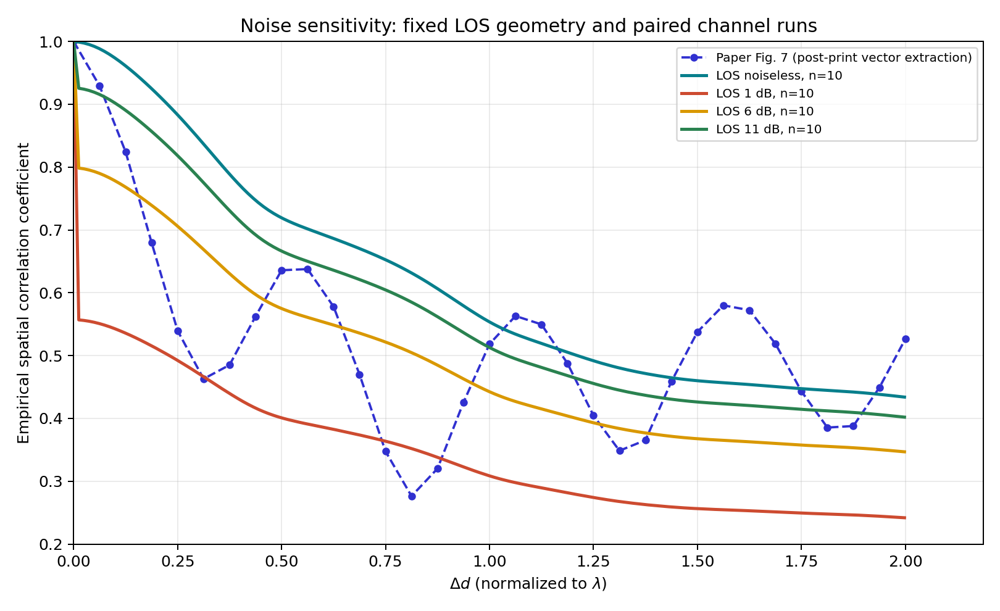
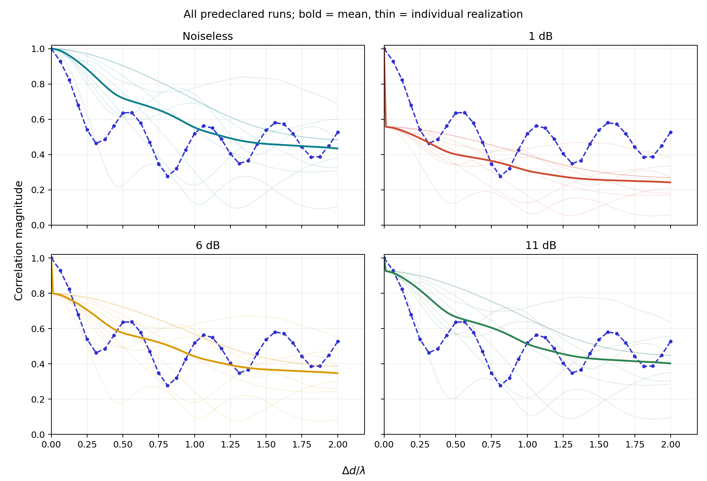
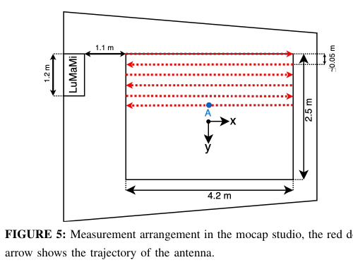

# A4 Follow-up: Observation Noise and Figure 5 Geometry

Student: M11502203 Ping-Yu Hsieh

Date: 2026-11-21 (Asia/Taipei)

## 1. Controlled Experiment

The paper reports per-frequency-point measurement SNR ranging from approximately 1 to 11 dB. The original A4 experiment instead used ideal, noiseless channel coefficients. This follow-up compares noiseless, 1, 6 and 11 dB observation models while retaining the same channel geometry and run IDs. These SNR settings are a predeclared sensitivity sweep, not an attempt to infer the original trajectory's SNR from Figure 7. [1]

For snapshot i with D = 100 × 100 complex entries, define mean signal power:

\[
P_i=\frac{1}{D}\sum_{a,f}|H_i(a,f)|^2,
\qquad
Y_i(a,f)=H_i(a,f)+\sqrt{\frac{P_i}{2\gamma}}(z_R+jz_I),
\quad \gamma=10^{\mathrm{SNR}_{dB}/10}.
\]

The standard normal samples z_R and z_I are independent across entries and snapshots. Noise is added before per-snapshot normalization and Equation (11) correlation. This fixes the **expected snapshot-average SNR**, not each tone's instantaneous SNR. The noise power follows snapshot signal power; this is not a constant receiver-noise-floor model or a reconstruction of actual pilot estimation.

All four settings share the same underlying channel for a given run. The three finite-SNR settings also share the same standard-normal sequence, scaled by the SNR-dependent factor. Channel seed is 20261109, channel stream start is 1, and observation-noise stream is 100001. Runs 1–10 are retained for every setting; the path lasts 42 s with 4,201 samples. Existing BS (0,0,2.5) m and UE start (2,2,1.73) m are unchanged. No noiseless baseline output is overwritten.

Source: [noisy-channel-correlation.cc](src/noisy-channel-correlation.cc), [runner](src/run-experiment.py), [analysis and checks](src/analyze-noise.py). The A3 exporter and original A4 simulation data remain unchanged.

## 2. Numerical Results

All 40 full simulations completed: 10 channel runs for each of the four settings. Ten noiseless reruns match the previous baseline exactly; the other 30 runs add noise. Each run has 4,201 snapshots and 163 lags. Four short-path settings were also repeated separately to check byte-identical CSV and witness output.

| Observation model | Mean-curve RMSE | Mean-curve MAE | Mean correlation at 1.998λ | Individual runs with lower RMSE than their noiseless counterpart |
|---|---:|---:|---:|---:|
| Noiseless | 0.1714 | 0.1301 | 0.4339 | Baseline |
| 1 dB | 0.1965 | 0.1683 | 0.2419 | 6 / 10 |
| 6 dB | 0.1207 | 0.1007 | 0.3468 | 9 / 10 |
| 11 dB | 0.1425 | 0.1076 | 0.4020 | 9 / 10 |

These dimensionless errors compare the ensemble-mean correlation curve with the same 32 reference vertices inside the simulated domain. They are not localization errors. The 6 dB mean-curve RMSE is 29.6% lower than the noiseless value. This is a descriptive result within the predeclared sweep, not independent validation that the measured trajectory had 6 dB SNR. Noiseless remains the recorded baseline; all SNR conditions are reported.

The error of the ensemble mean is not the mean of individual-run errors. Consequently, the 1 dB ensemble curve is worse even though 6 of 10 individual curves improve. Paired mean individual-run RMSE differences relative to noiseless are −0.0298 at 1 dB, −0.0618 at 6 dB and −0.0288 at 11 dB; sample SDs are 0.0942, 0.0563 and 0.0202 respectively. These are descriptive paired statistics, not significance tests.

### Why Noise Helps Only Partly

For independent observation noise and many channel entries, nonzero-lag correlation is approximately attenuated by:

\[
r_Y(k)\approx \frac{\gamma}{1+\gamma}r_H(k),\quad k>0.
\]

This is a high-dimensional approximation under our stated noise model, not a paper result or an exact identity. The experiment's nonzero-lag mean curves agree with that approximation to RMSE below 0.00004. Noise therefore mostly scales the nonzero-lag curve down; it does not create the measured oscillations.

At zero lag the same observation is correlated with itself, so the value remains 1. At the first nonzero lag, only 1 mm / 0.01233λ away, mean correlation is 0.9990 without noise, 0.5568 at 1 dB, 0.7985 at 6 dB and 0.9255 at 11 dB. That sharp near-zero drop is a consequence of independent snapshot noise and is not evidence that the original measurement behaves identically.

The 6 dB curve improves the overall error but undershoots the reference at long distances: near 2λ it is 0.3468 versus interpolated reference 0.5240. Adding noise does not solve the remaining geometric/scattering mismatch. In particular, more noise is not monotonically better: 1 dB worsens the mean-curve error.

Data: [summary and paired statistics](results/noise/summary.json), [configuration](results/noise/configuration.json), [execution records](results/noise/executions.json), [full vertical range](results/noise/comparison-full-scale.png). Per-setting aggregate CSVs and vector PDFs are in [results/noise](results/noise).

### Verification

[Validation evidence](results/noise/validation.json) records:

- 40 validated full runs and 120 pre-noise spectrum cross-checks.
- Exact original-baseline CSV matches for all ten noiseless runs.
- Identical clean channel witnesses across each run's four settings.
- Common-noise amplitude and energy scaling checks across 1/6/11 dB.
- Four repeatable short-path settings.
- Maximum target-versus-realized aggregate SNR difference of 0.001681 dB.

Realized run-level aggregate SNR spans 0.999119–1.001681 dB, 5.999119–6.001681 dB and 10.999119–11.001681 dB. This validates the implemented power convention; it does not establish an equivalent per-tone measurement SNR.

Reproduce with the commands under [src/README.md](src/README.md#paired-noise-sensitivity). The original A4 plots/data and A3 source remain intact. Roughly 0.7 GB of channel vectors per worker, plus overhead, are required; the batch used four workers.

## 3. Geometry Review: What Figure 5 Actually Shows

Source: the same university post-print used for Figure 7, PDF page 8 / printed page 6. PDF provenance is recorded in [reference/provenance.json](reference/provenance.json); the crop command is in [src/README.md](src/README.md). [1]

| Visible information | Interpretation |
|---|---|
| Scan-region dimensions 4.2 × 2.5 m | Defines the measurement region, not the full room dimensions |
| LuMaMi array to the left of the region | The first illustrated rightward trajectory moves away from the array along +x |
| Alternating right/left arrows | The illustrated scan is serpentine, not exclusively +x on every line |
| Approximately 0.05 m separation | The annotated shift between illustrated adjacent scan lines |
| 1.1 m horizontal annotation | Gap between the drawn LuMaMi face and the left edge of the scan region; not a proven phase-center-to-UE 3D distance |
| 1.2 m vertical annotation | Array extent in the plan view; not a BS mounting height |

The current first-path direction (+x) is qualitatively consistent with the first arrow, but the assumed (2,2) m initial horizontal offset was not reconstructed from this diagram. A figure-aligned geometry study would therefore be worthwhile. However, the drawing does not establish an exact antenna phase-center coordinate, mounting height, or element bearing/downtilt. The drawing's room boundary is schematic. Those quantities must remain assumptions unless supplementary measurement documentation supplies them.

For example, placing the array phase center at the midpoint of its drawn 1.2 m extent would suggest a lateral offset near 0.6 m to the top scan line, but that is **an inference**, not a reported coordinate. Likewise, converting the 1.1 m face-to-edge gap directly to phase-center distance requires an additional assumption. Neither was silently used to alter this noise experiment.

The proper next geometry experiment is separate: preserve these four noise controls, document the chosen phase-center convention and BS height, and compare the original assumed geometry against a Figure-5-aligned approximation. Changing geometry together with noise would obscure which change affected the curve.

Update, 2026-11-22: the user approved the stated phase-center approximation, and the separate [trajectory/direction study](geometry_study.md) has now been executed. The noise runs in this report still use their original geometry and are not overwritten or reinterpreted as geometry-aligned observations.

## References

[1] G. Tian et al., “Deep-Learning-Based High-Precision Localization With Massive MIMO,” IEEE TMLCN, vol. 2, pp. 19–33, 2024, doi: [10.1109/TMLCN.2023.3334712](https://doi.org/10.1109/TMLCN.2023.3334712). [University post-print](https://lucris.lub.lu.se/ws/portalfiles/portal/165039395/TMLCN.pdf), Figures 5 and 7, Section IV.
