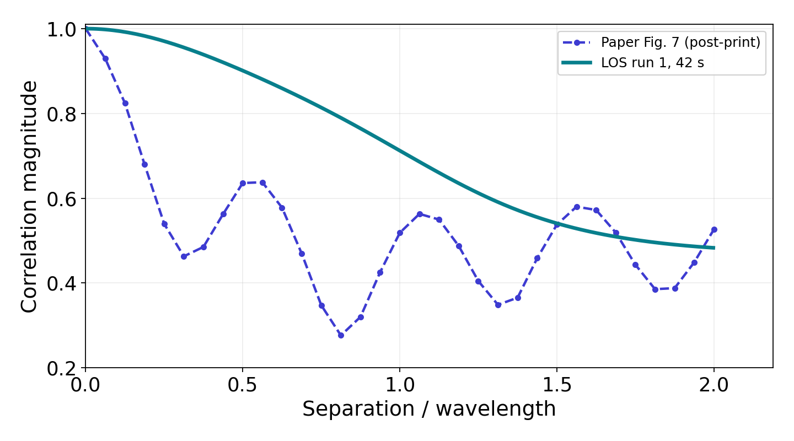
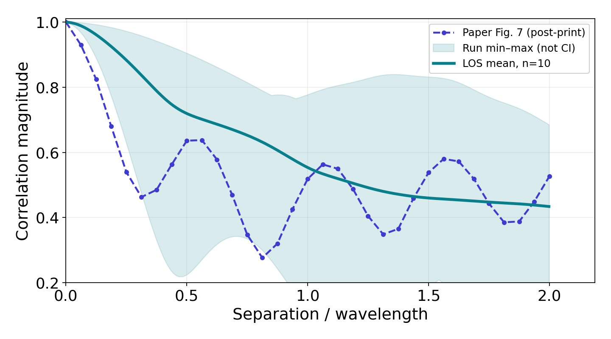
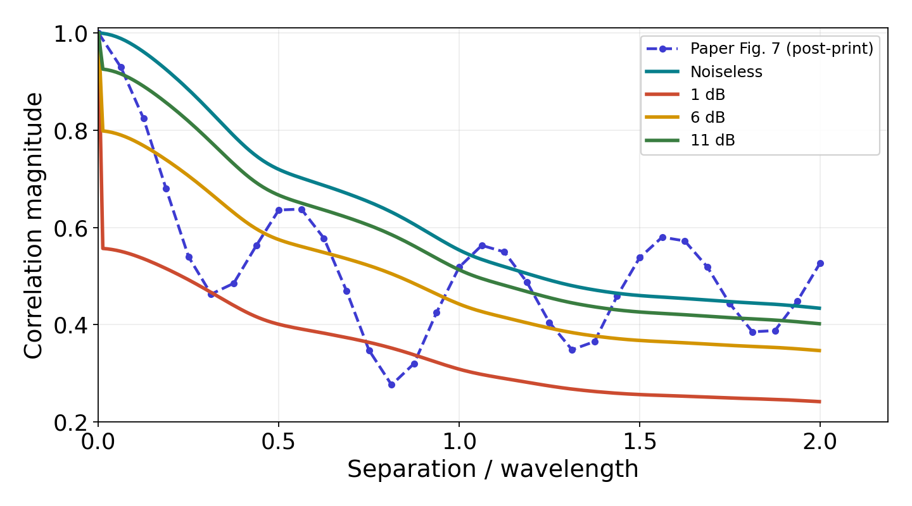
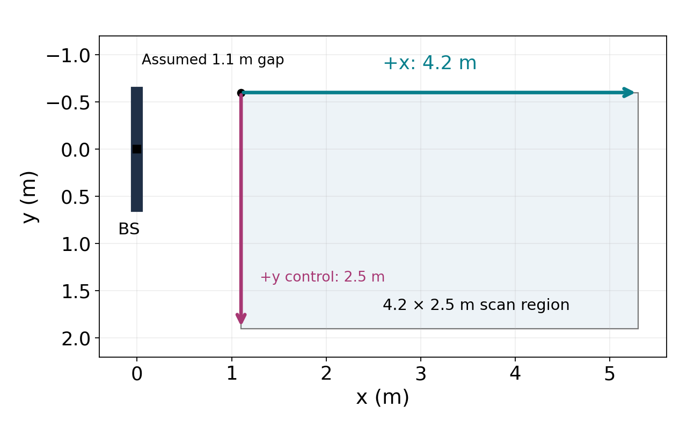
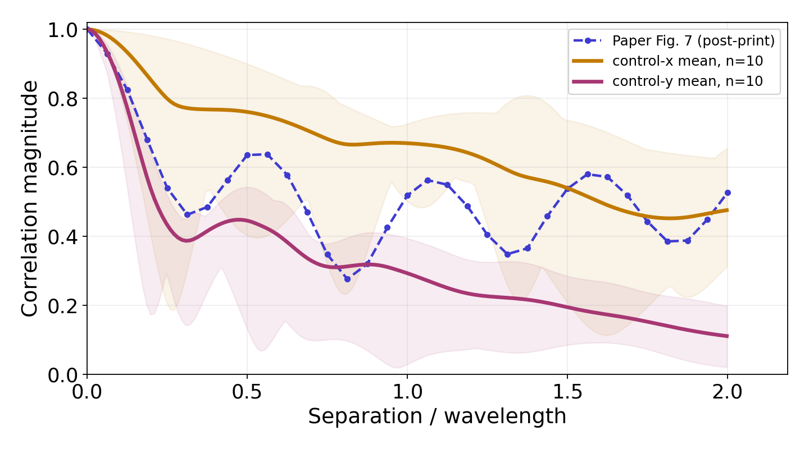
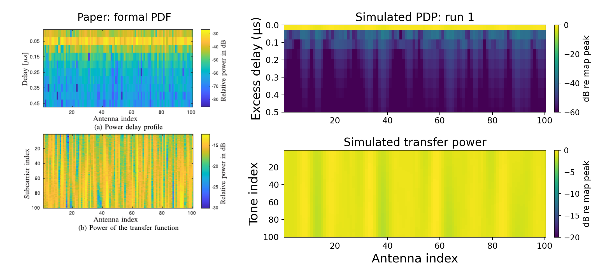

# A4 — English Presentation and Speaker Notes

16 main slides: suggested timing 15:00, excluding Q&A. Two backup slides are untimed. Timing is a rehearsal target, not a measured recording.

Sources: [main study](study_note.md), [noise](noise_study.md), [geometry](geometry_study.md), [small tests](sensitivity_study.md), [Figure 6](figure6_study.md).

Speaker notes are embedded in the PowerPoint. Graphs are redrawn from existing CSVs for presentation legibility; no new simulations are run.

## 1. Reconstructing Uplink Channel Structure (0:00–0:25)

A4 Baseline Reproduction | Figure 7 + Figure 6

- Ping-Yu Hsieh | M11502203
- ns-3 indoor channel experiments and measured-paper comparisons
- Outcome: reproducible observables, with remaining measurement mismatch

> The experiment is complete; exact numerical agreement is not established.

Speaker notes:

Today I will present my A4 baseline reproduction. I use ns-3 to reconstruct two channel observables from a published uplink massive-MIMO localization paper: the spatial-correlation curve in Figure seven and the channel-power maps in Figure six. The implementation and comparisons are complete, but I do not claim exact agreement with the measurements. I will show what matches qualitatively, what differs, and what the controlled tests actually establish.

Source: [1] Tian et al., IEEE TMLCN 2 (2024), 19–33

## 2. 01 What Result Am I Reproducing? (0:25–1:10)

Published reference and scope

- Paper: Deep-Learning-Based High-Precision Localization With Massive MIMO
- Figure 7: correlation magnitude versus UE separation
- Figure 6: delay-domain and frequency-domain channel power
- Channel-level baseline, not neural-network positioning accuracy

> No positioning-error result or complete FCNN/fusion pipeline is claimed.

Speaker notes:

The paper estimates indoor positions using uplink channel fingerprints. A single-antenna UE transmits pilots, and a massive-MIMO base station observes the channel. For A4, I choose the channel structure behind that localization task rather than reproducing every learning model. Figure seven gives an explicitly defined spatial-correlation statistic. Figure six shows delay and frequency power at one position. Both can be generated from ns-3 channel coefficients. This is therefore a channel baseline for the final project, not a reproduction of the paper’s positioning error. I do not claim standard NR-SRS decoding, hardware measurements, or the complete FCNN and uncertainty-fusion system.

Source: [1] Sections II and IV-B; Figures 6–7

## 3. 02 Observable and Processing Pipeline (1:10–2:05)

Compute the same statistic before comparing curves

- Plot |rho(k)| against separation / wavelength; never average pairwise magnitudes first.
- Uplink channel: UE → BS; Complex coefficients; and cluster delays
- Frequency response: 100 antennas; × 100 tones; at each position
- Correlation: Normalize pairs; Complex average; then magnitude
- Comparison: Same axes; Reference overlay; Explain differences

> Within-run complex averaging and across-run magnitude averaging are different.

Speaker notes:

At each position, I construct one complex frequency-response matrix and flatten its antenna and frequency entries into a vector. For a selected displacement lag, I compute the normalized complex inner product for every valid pair of positions. I average those complex values, and only then take the magnitude. Taking each pair’s magnitude before averaging would produce a different observable. Across independent channel runs, however, the reported ensemble curve averages the already computed per-run magnitudes. Those two averaging operations should not be confused. The horizontal axis is displacement divided by wavelength. This processing definition is fixed before I compare any settings or interpret whether a curve is close to the paper.

Source: [1] Equation (11); A4/src/channel-correlation.cc

## 4. 03 Original Settings and Declared Assumptions (2:05–3:05)

Matched quantities are separated from simulator choices

- Paper-aligned | 3.7 GHz; 4 × 25 BS array; approximately 0.5λ spacing
- Observed tones | 100 tones; 180 kHz spacing is our LTE-grid interpretation
- Motion / sampling | 0.1 m/s; 10 ms recording; 1 mm displacement
- Baseline geometry | BS (0,0,2.5) m; UE starts (2,2,1.73) m, moving +x
- Channel / path | InH-OfficeMixed; LOS primary; assumed 4.2 m / 42 s
- RNG / repetitions | Seed 20261109; runs 1–10; channel stream start 1

> The measured studio is not reconstructed by a statistical office model.

Speaker notes:

Several quantities are aligned with the paper: the carrier, the one-hundred-element array, the number of observed tones, the movement speed, and the recording interval. Other quantities are explicit project choices. The initial baseline uses the indoor office mixed statistical channel, with a four-point-two-meter path and assumed endpoint coordinates. Forty-two seconds is derived from that path length and speed; it is not an original reported simulator duration. The paper is a measurement campaign, so it has no simulator seed list for me to copy. I record seed twenty million two hundred sixty-one thousand one hundred nine, run IDs one through ten, and channel stream start one. No UDP workload or MAC scheduler is required for this coefficient-level observable.

Source: [1] Section IV-A; A4/results/full/configuration.json

## 5. 04 Verification Before Interpretation (3:05–3:50)

Execution correctness is necessary, not physical validation

- Platform | ns-3.48; source revision and compiler recorded
- Exporter checks | First / middle / last snapshot versus ns-3 spectrum conversion
- Numerical invariants | Finite values; expected dimensions; |rho(0)| = 1; bounded magnitude
- RNG checks | Fixed seed/run repeats; changed runs produce distinct outputs
- Independent regression | Old source preserved; new default settings reproduce earlier CSVs

> Passing numerical tests does not prove agreement with measured propagation.

Speaker notes:

Before interpreting the curves, I check that the program executes the intended calculation. The exported frequency response is compared with ns-3’s own spectrum conversion at selected snapshots. I verify dimensions, finite values, unit zero-lag correlation, and the upper bound of one. Fixed RNG settings repeat, while different channel runs produce different outputs. Later exporters also reproduce earlier default-setting outputs, so a code change is not silently mistaken for a physical effect. The installed official channel test suite passed as well. These checks establish implementation consistency. They do not prove that the statistical model represents the actual measurement room.

Source: [2] ns-3.48; A4/results/validation.json and per-study validation records

## 6. 05 Figure 7: One Trajectory Versus One Run (3:50–5:00)

Primary single-run comparison, with no best-run selection

- Preselected LOS run 1
- Curve RMSE: 0.2670
- 32 reference points in the common domain
- Different decay and oscillations



> Curve RMSE is dimensionless; it is not positioning error in meters.

Speaker notes:

This is the most direct comparison: the paper’s single measured trajectory against my preselected LOS run one. I did not inspect every run and choose the one that looked most similar. The axes represent the same correlation observable and normalized displacement. The reference is recovered from the university post-print’s vector curve. I compare thirty-two reference vertices inside the simulated domain; the simulated maximum lag is one point nine nine eight wavelengths, so I do not extrapolate to the reference endpoint at exactly two. The curve RMSE is about zero point two six seven. This number is dimensionless, not meters. The plotted shapes differ, including the initial decay and the positions of peaks and valleys. Completing the calculation is not the same as achieving a close numerical match.

Source: [1] Fig. 7; reference/figure7.csv; results/full/los/run-01

## 7. 06 Figure 7: Variability Across Channel Runs (5:00–6:05)

Ten-run summary supplements the single-run comparison

- LOS mean RMSE: 0.1714
- Shading: observed min–max
- Not a confidence interval
- Large realization variability remains



> An ensemble mean is not a substitute for the paper’s individual trajectory.

Speaker notes:

The ensemble plot shows the mean over ten independently seeded channel realizations. Its curve RMSE is about zero point one seven one four, smaller than the preselected single run’s value. That does not mean averaging has reproduced the same measured environment. The shaded region is the observed minimum-to-maximum envelope across runs, not a confidence interval. It shows substantial realization variability. Averaging can smooth oscillations that occur at different locations in different realizations, so I retain the single-run comparison rather than presenting only the smoother mean. The baseline contains ten LOS and ten NLOS runs, but LOS remains the primary configuration. A slightly smaller NLOS error is sensitivity evidence, not a reason to rename the primary model after seeing the reference.

Source: results/los-aggregate.csv; results/summary.json

## 8. 07 Does Observation Noise Explain the Gap? (6:05–7:20)

Same channel runs; noiseless / 1 / 6 / 11 dB

- Noiseless RMSE: 0.1714
- 6 dB RMSE: 0.1207
- 1 dB makes the mean fit worse
- All settings retained



> Noise lowers nonzero-lag correlation, but does not recreate the measured peaks.

Speaker notes:

The first controlled test adds independent complex observation noise before normalization. The paper reports measurement SNR in the approximate range of one to eleven decibels, while the baseline has no receiver noise. I therefore predeclare noiseless, one, six and eleven decibel settings. Every setting shares the same channel run, and the finite-SNR cases share the same standard-normal draws with different scaling. Six decibels reduces ensemble-curve RMSE from zero point one seven one four to zero point one two zero seven, about a thirty-percent reduction. But one decibel makes the ensemble fit worse. The independent-snapshot noise mostly attenuates nonzero-lag correlation and introduces a near-zero-lag drop; it does not create the measured sequence of peaks. This simplified snapshot-average SNR convention is not actual pilot estimation or proof of the paper’s true SNR.

Source: results/noise/summary.json; noise_study.md

## 9. 08 Aligning the Approximate UE Trajectory (7:20–8:30)

Figure 5 proportions, with explicit phase-center assumptions

- Assumed UE start: (1.1, −0.6, 1.73) m
- BS height remains 2.5 m
- Mean-curve RMSE: 0.1445
- Only 4 / 10 individual runs improve



> A closer ensemble curve does not establish the original physical coordinates.

Speaker notes:

Next I use the diagram in Figure five to construct an approximate first trajectory. The drawing places the base station to the left of a four-point-two by two-point-five-meter region, with a labelled one-point-one-meter gap. The phase-center convention is not supplied, so I explicitly assume how the drawn face and midpoint map to coordinates. The first UE position is one point one, minus zero point six, and one point seven three meters. Base-station height remains an assumed two point five meters. The first trajectory moves in positive x, away from the array. The ten-run mean-curve error improves to about zero point one four four five. However, only four of ten individual runs improve. Thus this is a useful geometry sensitivity result, not recovery of the true room or consistently better accuracy.

Source: [1] Fig. 5; geometry_study.md; results/geometry/summary.json

## 10. 09 Direction Matters; Sample Order Does Not (8:30–9:30)

Matched 2.5 m paths from the same initial position

- +x at 1.998λ: 0.476
- +y at 1.998λ: 0.111
- +y lower in all 10 matched runs
- Reversal error below 7 × 10⁻¹³



> This demonstrates simulator sensitivity, not the cause of the paper’s oscillations.

Speaker notes:

To separate direction from trajectory length, both controls start at the same position and travel two point five meters for twenty-five seconds. One moves in positive x and the other in positive y. At approximately two wavelengths, mean correlation is zero point four seven six for positive x and zero point one one one for positive y. The transverse path has lower final correlation in all ten matched runs. It still has worse full-curve agreement with the paper, so faster decay alone is not enough. Separately, reversing the exact same stored samples preserves correlation magnitude within numerical error. Changing the path relative to the geometry is therefore different from simply reading the same trajectory backward. Cross-path consistency of a fixed radio map remains unverified.

Source: results/geometry/direction-summary.json; results/geometry/validation.json

## 11. 10 Small Tests: Height and Array Bearing (9:30–10:30)

One factor at a time; the same five run IDs per setting

- Height / bearing | Curve RMSE | Improved runs
- 2.5 m / 0° reference | 0.1844 | Reference
- 1.73 m / 0° | 0.2538 | 2 / 5
- 3.0 m / 0° | 0.1498 | 3 / 5
- 2.5 m / −30° | 0.1646 | 5 / 5
- 2.5 m / +30° | 0.1708 | 3 / 5

> Matched five-run reference = 0.1844; do not compare it with ten-run means.

Speaker notes:

The small screen varies only base-station height or array bearing, keeping the trajectory and noiseless LOS condition fixed. To limit workload, every setting uses the same first five channel run IDs. The correct five-run reference error is zero point one eight four four, which must not be confused with previous ten-run means. Height three meters has the smallest ensemble-curve error, but improves only three individual runs. Bearing minus thirty degrees improves all five paired runs, although its mean curve is not the lowest-error setting. This makes that bearing a more consistent exploratory candidate, not a measured physical calibration. Five runs are not a convergence guarantee or a significance test, and I have not combined the best height, bearing, and noise settings into a fitted optimum.

Source: results/sensitivity/metrics.csv; sensitivity_study.md

## 12. 11 Figure 6: From Frequency to Delay (10:30–11:35)

A second observable at one stationary approximate position

- 100 tones × 180 kHz ⇒ native delay bins of 55.56 ns, not silently relabelled 50 ns.
- Point A ≈ (3.19, 0.42, 1.73) m is a schematic estimate, not a surveyed coordinate.
- Static channel: Approximate point A; 100 × 100 complex H; at t = 0
- Frequency power: |H(a,k)|²; Antenna × tone; heatmap
- Delay power: IDFT along tones; |g(a,n)|²; First ~0.5 μs
- Verification: Delay-sum check; FFT round trip; Parseval energy

> Each heatmap uses one explicit global-peak dB reference, not per-antenna scaling.

Speaker notes:

Figure six adds a second observable without requiring a positioning network. I generate one static complex channel at an approximate position A, estimated from the diagram, rather than taking a forty-two-second trajectory. Squared magnitude gives transfer-function power. An inverse DFT along the observed tones gives a delay-domain response, whose squared magnitude forms the PDP heatmap. The actual grid matters: one hundred tones separated by one hundred eighty kilohertz gives fifty-five point five six nanosecond bins. I do not label those bins as fifty nanoseconds merely because nominal system bandwidth is twenty megahertz. I also keep all complex coefficients and verify direct reconstruction, FFT round-trip, and energy conservation. These checks concern signal processing, not an exact reconstruction of the measured antenna or room.

Source: [1] Sections II-B / IV-B; figure6_study.md

## 13. 12 Figure 6: Qualitative Agreement and Limits (11:35–12:50)

Formal-paper image versus preselected simulated run 1




> Early energy concentration is reproduced qualitatively; measured deep dips are not.

Speaker notes:

The original image is on the left and the simulated maps are on the right. The simulation has strong early delay concentration: preselected run one places 99.9873 percent of IDFT energy in its first three bins. Across ten channel runs the mean is about 99.64 percent. Antenna-index power roughness exceeds frequency-index roughness in all ten runs, which supports the qualitative observation that frequency variation is smoother. However, the simulated run is visibly smoother than the measurement, and its transfer-power range is only about two point two decibels. Each simulated panel uses its own explicit global-peak reference, which differs from the paper’s unavailable full measurement normalization. Therefore color values are not absolute matches, and I do not report an unjustified pixelwise image error. The point-A coordinates and antenna mapping also remain approximate.

Source: [1] Fig. 6, formal PDF; results/figure6/summary.json

## 14. 13 What Explains the Remaining Difference? (12:50–13:45)

Confirmed differences are not uniquely identified causes

- Verified | Noise, geometry, direction, height and bearing alter the simulated result.
- Not reproduced | The complete measured oscillation pattern and detailed channel-power maps.
- Plausible, unproven | Scene-specific multipath phase evolution, RF effects and measurement processing.
- Paper wording | The article describes Fig. 7 decay; it does not explicitly identify the oscillation mechanism.

> Do not equate a closer curve with discovery of the true physical cause.

Speaker notes:

What can I conclude about the remaining difference? The experiments confirm that several settings influence the simulated observables. They do not identify the unique cause of the measured oscillations. The actual studio’s scatterer geometry, propagation directions, radio-chain effects, and processing conventions are not fully reconstructed. Multipath phase evolution is a physically plausible interpretation of alternating cancellation and reinforcement, but it is not a mechanism established by these tests or explicitly identified for Figure seven in the paper. Some settings improve a chosen discrepancy metric without reproducing the peaks and valleys. That is why I report all predeclared settings and keep the original baseline instead of continuing to tune until a plot looks convincing.

Source: [1] Section IV-B; A4 controlled studies

## 15. 14 Reproducibility and Delivered Evidence (13:45–14:25)

Parameters, seeds, run count, code and original-figure provenance

- Baseline | 10 LOS + 10 NLOS; 42 s; seed 20261109; runs 1–10
- Controlled studies | Noise: 40 runs; trajectory: 30; height/bearing: 20 new + 5 reused
- Figure 6 | 10 stationary realizations + repeated run 1; no trajectory duration
- Artifacts | Source, manifests, raw CSVs, hashes, validation records and plots
- Reference provenance | Fig. 7: post-print vector curve; Fig. 6: formal PDF crop

> Run totals include controls; study results must not be pooled as independent samples.

Speaker notes:

The submission includes the requested study note, flowcharts, simulation and analysis source, raw numerical results, and comparison figures. Each experiment records configuration, source revision, seed, channel run IDs, and execution hashes. The forty noise runs include ten noiseless reruns; they are not forty independent measured environments. Likewise, the small screen reuses its reference runs. Figure six has static realizations, not another moving-trajectory experiment. Reference provenance is explicit: Figure seven uses a university post-print curve, whereas Figure six uses the user-supplied formal PDF. The notes and appendix provide the rebuild commands and source locations.

Source: A4/src/README.md; per-study configuration/execution/validation JSON

## 16. 15 Conclusion and Final-Project Connection (14:25–15:00)

A reproducible baseline with an explicit boundary of validity

- Completed: two channel observables, reference comparisons, and controlled tests.
- Not established: exact measured oscillations or their unique physical cause.
- Final: validate cross-path radio-map consistency before RF / KNN / MLP training.

> Useful baseline evidence does not require pretending the curves match.

Speaker notes:

My conclusion is that the channel observables and the controlled experiments are reproducible, but the measured curves are not fully reproduced. I can explain which assumptions differ and show how selected factors affect the model, without claiming a uniquely identified cause. This gives the final project a documented starting point. Before generating a localization dataset, I still need to validate cross-path and revisited-position consistency. Only after that should I compare RF, KNN and a lightweight MLP. Thank you.

Source: A4/study_note.md; A3/proposal.md

## 17. Backup A: References and Source Locations (backup)

Untimed appendix

- [1] Main paper | Tian et al., IEEE TMLCN, vol. 2, pp. 19–33, 2024. DOI: 10.1109/TMLCN.2023.3334712
- [2] Simulator | ns-3.48 commit d2add90b452d600cfb4859baed8e9ea633519447
- Main result | A4/study_note.md; A4/results/summary.json
- Follow-ups | noise_study.md; geometry_study.md; sensitivity_study.md; figure6_study.md
- Rebuild commands | A4/src/README.md; A4/presentation.md

> Original measurement raw data and exact room reconstruction are not available.

Speaker notes:

Use this slide only if asked about sources. The published citation is the 2024 volume article; the DOI contains the earlier online-publication year. The Figure seven reference is extracted from the accepted post-print and is labelled accordingly. Figure six comes from the formal IEEE PDF supplied by the user. Software and source hashes are recorded with the experiment, not inferred from a version label alone.

Source: Sources and provenance are linked in the repository reports.

## 18. Backup B: Questions to Anticipate (backup)

Untimed appendix

- Why no UDP? The observable is the channel, not application throughput.
- Is it NR SRS? No waveform reception or SRS estimation is implemented.
- Why does the baseline number change? Five-run and ten-run means differ.
- Did we find the oscillation cause? No; controlled sensitivities are not identification.

> Same-data reversal is invariant; a new reverse-motion simulation is a different test.

Speaker notes:

These are short answers to likely questions. Channel-level extraction does not require packet traffic. Uplink direction does not imply a standardized SRS receiver. Always compare settings on matching run subsets, and distinguish an ensemble mean from a measured trajectory. More parameter tuning would not, by itself, establish the true propagation mechanism. The next physical-model improvement would require independently justified geometry, channel observations or a documented propagation model, rather than selecting a convenient curve.

Source: See individual study reports for evidence and caveats.

## Rebuild and Export

```bash
python3 A4/src/build-presentation.py
libreoffice -env:UserInstallation=file:///tmp/a4-slides-lo --headless --convert-to pptx --outdir A4 A4/A4-baseline-reproduction-en.odp
libreoffice -env:UserInstallation=file:///tmp/a4-slides-lo --headless --convert-to pdf --outdir A4 A4/A4-baseline-reproduction-en.odp
```

Simulation and analysis commands: [src/README.md](src/README.md). Rebuilding these slides does not rerun simulations.
