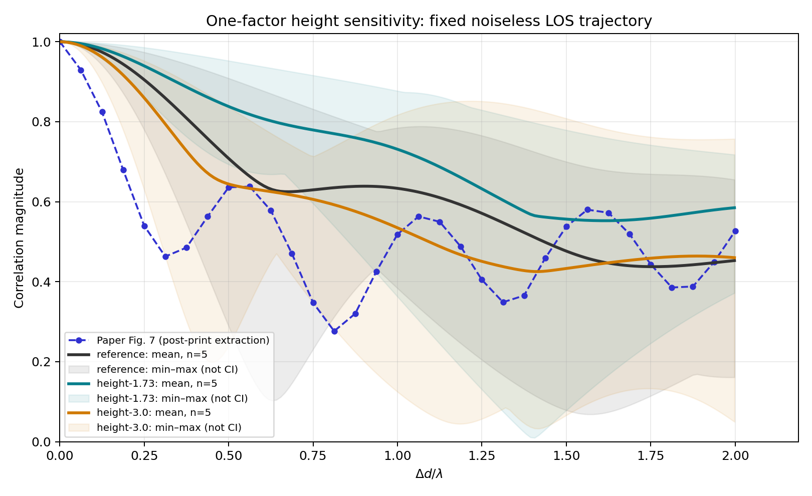
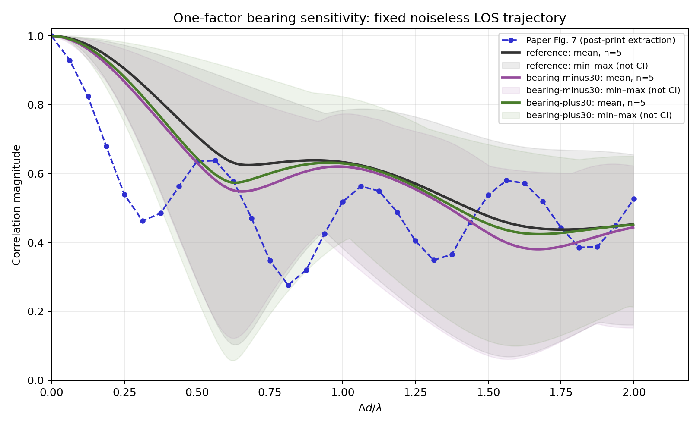

# A4 Small-Workload Tests: BS Height and Array Bearing

Student: M11502203 Ping-Yu Hsieh

Date: 2026-11-22 (Asia/Taipei)

## 1. Predeclared Design

This exploratory follow-up varies BS height or array bearing, one factor at a time. It keeps the approved approximate Figure 5 first trajectory: UE starts at (1.1,−0.6,1.73) m and moves +x at 0.1 m/s for 4.2 m / 42 s. All runs use noiseless LOS, `InH-OfficeMixed`, the same BS horizontal coordinate (0,0), and zero array downtilt. The 3.7 GHz carrier, 4 × 25 half-wavelength BS array, 100 frequency samples at 180 kHz spacing, and 10 ms sampling remain unchanged.

| Profile | BS height | BS bearing | Source |
|---|---:|---:|---|
| Reference | 2.5 m | 0 degrees | Reuse existing `paper-x-full` runs 1–5 |
| Height test A | 1.73 m | 0 degrees | Five new runs |
| Height test B | 3.0 m | 0 degrees | Five new runs |
| Bearing test A | 2.5 m | −30 degrees | Five new runs |
| Bearing test B | 2.5 m | +30 degrees | Five new runs |

Every setting uses seed 20261109, channel stream start 1 and matched run IDs 1–5. The prior ten-run reference mean must not be used in this five-run comparison. These parameter values are exploratory assumptions, not recovered paper settings. At the initial UE position, its horizontal direction from the BS is approximately −28.6 degrees; −30 degrees therefore roughly points toward the initial UE in the stated coordinate convention. The UE-to-BS direction changes along the trajectory.

No SNR sweep, model-table edits, K-factor calibration, full parameter grid or counterfactual transverse trajectory is included. A smaller curve error on this single measured reference is descriptive fit, not evidence that the original BS had that height or bearing.

## 2. Implementation and Reproduce

[The separate exporter](src/sensitivity-channel-correlation.cc) extends the original noiseless probe with BS-height and array-bearing arguments. It does not modify any source used by previous experiments. The first, midpoint and endpoint frequency responses are checked against ns-3's spectrum conversion, including at nonzero bearing. This preserves the existing documented delay-cache workaround without modifying the simulator library.

```bash
python3 A4/src/run-sensitivity.py --pilot --workers 2
python3 A4/src/run-sensitivity.py --runs 5 --workers 4
python3 A4/src/analyze-sensitivity.py
```

The pilot contains a short old-geometry regression, a full-length current-reference regression, and a short rotated-array cross-check. The full batch contains twenty new 4,201-snapshot runs. Five existing reference runs are reused, with source paths/hashes recorded by analysis. Reusing output directories overwrites that experiment; old baseline/noise/geometry directories are protected against accidental selection by the new runner.

Five runs per setting provide a small exploratory screen, not a convergence or statistical-significance claim. A promising setting would require additional predeclared runs or independent reference evidence before it could be treated as a reliable physical calibration. Exact phase-center geometry, room scatterers and original mounting height remain unknown.

## 3. Results

Twenty new full simulations completed successfully. The comparison also reuses five existing reference runs. All mean curves therefore have n = 5 with identical run IDs; the reference's RMSE here is 0.1844, not the 0.1445 from the previous ten-run mean. These are different ensemble subsets, not an unexplained baseline change.

Errors use the same 32 original-reference vertices inside the simulated domain and the established linear interpolation rule. No extrapolation to exactly 2 wavelengths is performed. Curve RMSE is dimensionless and must not be interpreted as position RMSE.

| Setting | BS height | Bearing | Mean-curve RMSE | Mean-curve MAE | Individually improved runs versus matching reference |
|---|---:|---:|---:|---:|---:|
| Reference | 2.5 m | 0 degrees | 0.1844 | 0.1451 | Reference |
| Lower BS | 1.73 m | 0 degrees | 0.2538 | 0.2140 | 2 / 5 |
| Higher BS | 3.0 m | 0 degrees | 0.1498 | 0.1126 | 3 / 5 |
| Rotate toward initial UE | 2.5 m | −30 degrees | 0.1646 | 0.1303 | 5 / 5 |
| Opposite bearing offset | 2.5 m | +30 degrees | 0.1708 | 0.1333 | 3 / 5 |

### Height



The 3.0 m ensemble mean has 18.7% lower curve RMSE than the matched reference, while 1.73 m increases the error by 37.6%. However, height 3.0 m improves only three individual runs. Its paired individual-run RMSE difference has mean −0.00740 and sample SD 0.05958. Thus the ensemble-mean improvement is not a robust uniform gain across this small sample.

The lower BS tends to preserve higher correlation over this trajectory. At 1.998λ its mean is 0.5848 versus reference 0.4527; the 3.0 m case is 0.4600. These are observations for this model/path, not a universal monotonic relationship between height and correlation.

### Bearing



The −30-degree setting reduces mean-curve RMSE by 10.7% and improves all five paired individual runs. Mean paired individual-run RMSE difference is −0.02694, with sample SD 0.02696. The +30-degree setting lowers mean-curve RMSE by 7.4% but improves only three runs; its paired difference is −0.00736 with sample SD 0.05354. No significance test or independent validation is claimed.

The −30-degree mean differs from the reference mean by at most 0.0820 across the plotted lags. This is a modest shape change, not a reconstruction of all measured peaks and troughs. At approximately 0.247λ, its mean remains 0.8703; the reference curve recovered from the paper is approximately 0.5470 there. Early simulated decay remains too slow.

Changing bearing alters array orientation, the element-pattern weighting and array response. Changing height alters link geometry and path evolution. These are interpretations consistent with the implemented controls, not evidence identifying the original paper's oscillation mechanism. Paired RNG IDs do not prove the same measured scatterer map across configurations.

### What This Screen Supports

Among these small tests, −30-degree bearing is the more consistent candidate for a further predeclared replication because all five individual discrepancies decrease. Height 3.0 m has the lowest ensemble-mean RMSE but weaker paired consistency. Neither result justifies replacing the original baseline, inferring the real mounting height/bearing, or claiming the original oscillations are explained. Combining 3.0 m, −30 degrees and the previously best SNR would be a new multi-factor experiment and was not done here.

Shaded envelopes show observed min–max ranges, not confidence intervals. Original-axis PNGs and vector PDFs are available next to the full-scale figures.

Data: [metrics CSV](results/sensitivity/metrics.csv), [per-run errors and aggregate summary](results/sensitivity/summary.json), [reference input paths/hashes](results/sensitivity/reference-inputs.json), [configuration](results/sensitivity/configuration.json), [execution records](results/sensitivity/executions.json).

## 4. Verification

[Validation record](results/sensitivity/validation.json):

- Twenty successful new full runs, with 4,201 snapshots and 163 lags each; five reference runs reused with recorded hashes.
- Sixty full-run spectrum-conversion cross-checks, three for each new run.
- Three pilot runs covering original short regression, full reference regression and nonzero-bearing conversion.
- Byte-identical CSVs for both old short and current full reference regressions.
- Expected paths and parameter witnesses, moving channel updates, finite bounded correlations and unit zero-lag values verified.

Existing baseline/noise/geometry sources and data were preserved. Python compilation and repository whitespace checks passed. The following tests remain unperformed: more channel runs, fixed-map cross-path validation, downtilt sweep, joint height/bearing/noise calibration, and measurement-grounded identification of BS phase-center coordinates.
