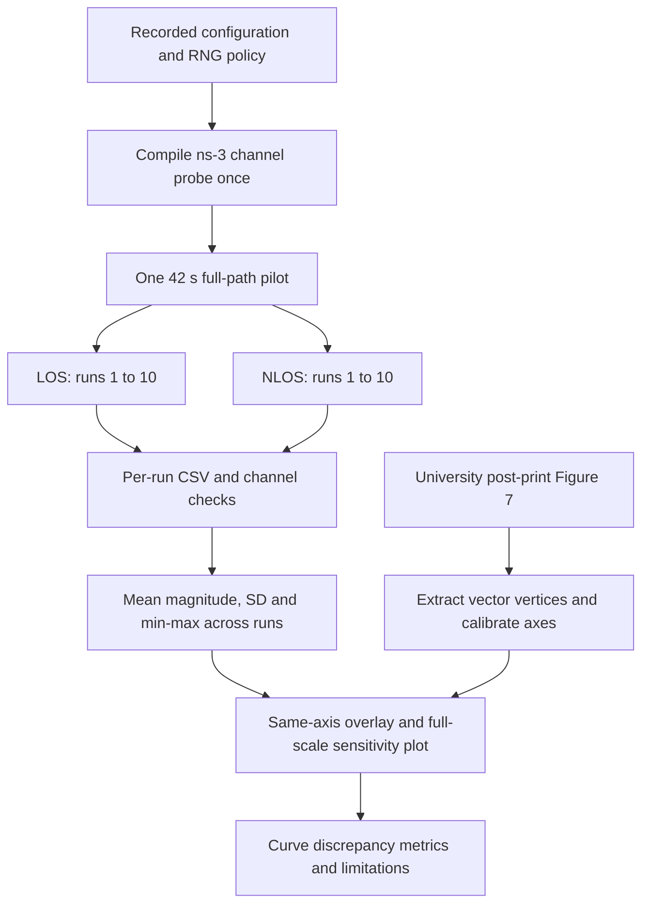

# A4 Simulation and Analysis

Run from the repository root with Python 3, NumPy, Matplotlib, GCC 12 and an existing ns-3.48 build. Reference extraction additionally requires Poppler utilities (`pdftocairo`, `pdftoppm`).

```bash
python3 A4/src/run-experiment.py --runs 1 --conditions los --workers 1 --output A4/results/pilot
python3 A4/src/run-experiment.py --runs 10 --workers 2 --output A4/results/full
python3 A4/src/analyze.py
python3 A4/src/validate.py
```

The default simulator directory is `/home/karl/projects/ns-3.48-nr`. Override it with `--ns3 /absolute/path/to/ns-3.48`. The runner records its source revision and compiler, compiles once into a retained temporary directory, and launches separate RNG runs. It deliberately selects the system linker using `-B/usr/bin/` to avoid incompatible Homebrew dependencies on this machine. Simulator versions and filenames are pinned to ns-3.48; another version requires explicit adaptation and revalidation.

`channel-correlation.cc` reuses the existing validated implementation in `../../A3/src/channel-spatial-probe.cc`. Both subtrees are required; this is not a standalone single-file download. Its source SHA-256 is recorded in the configuration. The A3 checker is also reused. No external simulator source is modified.

Each run stores correlation values, a small channel witness, stdout/validation logs and execution metadata. Full 100-by-100 channel matrices are held in memory during each run but not written as a final-project radio map. Allow approximately 0.7 GB for channel vectors alone per active run, plus simulator overhead. Re-running into an existing output directory overwrites that experiment's files; choose a new `--output` directory to retain an earlier experiment.

## Reference Recovery

Download the university-hosted paper locally, then supply its path:

```bash
curl -L --fail 'https://lucris.lub.lu.se/ws/portalfiles/portal/165039395/TMLCN.pdf' -o /tmp/a4-paper.pdf
python3 A4/src/extract-reference.py /tmp/a4-paper.pdf
```

The reference extractor is deliberately specific to this PDF version and Figure 7. It checks that exactly one blue curve with 33 vertices exists on PDF page 9, and applies manually verified axis calibration. A failed check requires inspecting the new source, not relaxing the check until it passes. The source PDF is not redistributed in this repository. See `../reference/provenance.json` for its hash and calibration.

## Flowchart



Compute the normalized complex correlation for each position pair, average complex values within each run/lag, and only then take magnitude. Across runs, average those magnitudes; the shaded envelope is the observed min-max range, not a confidence interval. `analyze.py` also stores sample SD. Reference-comparison metrics use only the common domain, without extrapolating the simulation to 2 wavelengths.

## Paired Noise Sensitivity

```bash
python3 A4/src/run-experiment.py --noise-study --samples 257 --runs 1 --workers 2 --output A4/results/noise-pilot
python3 A4/src/run-experiment.py --noise-study --samples 257 --runs 1 --workers 2 --output A4/results/noise-repeat
python3 A4/src/run-experiment.py --noise-study --runs 10 --workers 4 --output A4/results/noise
python3 A4/src/analyze-noise.py
```

This runs only LOS, preserving baseline geometry, with four settings per channel run: noiseless, 1, 6 and 11 dB. `noisy-channel-correlation.cc` is a separate exporter based on the original A3 implementation, which remains unchanged. Its disabled-noise output must match the original LOS CSV exactly. Configuration records both exporter hashes.

Noise is independent circular complex Gaussian at the frequency-response observation stage, before normalization. The expected signal-to-noise ratio is set using mean signal energy across all antenna/tone entries in each snapshot. This is not constant per-tone SNR, fixed receiver noise power across the path, actual RF-chain modelling or real pilot decoding. Channel stream start remains 1; the observation-noise normal RNG stream is 100001. Common standard-normal draws across SNR settings allow paired scaling checks; noise draws remain independent across time and entries within each simulated observation sequence.

`analyze-noise.py` verifies all 40 runs, channel-witness equality across SNR, exact noiseless baseline hashes, short-run repeatability, expected noise scaling and realized aggregate SNR tolerance of 0.02 dB. It writes separate products under `results/noise`, never replacing baseline plots. The full-batch settings are currently fixed to ten 4,201-snapshot runs per SNR for analysis.

Source Figure 5 crop was produced from the same PDF used for Figure 7:

```bash
pdftoppm -f 8 -l 8 -scale-to 1700 -x 130 -y 522 -W 500 -H 385 -png -singlefile /tmp/a4-paper.pdf A4/reference/figure5-source
```

The 1.1 m annotation is the plan-view gap between the drawn LuMaMi face and the scan-region edge. The 1.2 m annotation is a plan-view array extent, not a BS elevation. Geometry was inspected, not changed in the paired noise experiment.

## Trajectory and Direction Controls

```bash
python3 A4/src/run-geometry.py --pilot --runs 1 --workers 2
python3 A4/src/run-geometry.py --pilot --runs 1 --workers 2 --output A4/results/geometry-repeat
python3 A4/src/run-geometry.py --runs 10 --workers 4
python3 A4/src/analyze-geometry.py
```

`geometry-channel-correlation.cc` is a separate noiseless exporter with explicit UE initial x/y and planar heading parameters. It uses the full velocity-vector Doppler projection and checks every lag's reverse-order correlation against the complex conjugate of the forward result. A `.reverse.csv` and `.reversal.json` accompany each correlation CSV. The original A3 exporter and noisy exporter are not edited.

Profiles and assumptions are described in [geometry_study.md](../geometry_study.md). Two pilot profiles check baseline regression and +y spectrum consistency; repeat pilots verify CSV/witness/reverse-file reproducibility. Thirty full runs implement the 4.2 m Figure-5-aligned approximation and the equal-length 2.5 m +x/+y controls. `analyze-geometry.py` verifies positions, velocities, every-lag reversal, exact initial +x/+y channel witnesses, and the full-path/+x-control prefix match. It then plots the paths, curve comparisons and across-run ranges. This is not a full two-dimensional radio-map consistency test.

## Small Height and Bearing Screen

```bash
python3 A4/src/run-sensitivity.py --pilot --workers 2
python3 A4/src/run-sensitivity.py --runs 5 --workers 4
python3 A4/src/analyze-sensitivity.py
```

This uses `sensitivity-channel-correlation.cc`, a separate copy of the original noiseless exporter with `--bsHeight` and `--bearingDegrees` options. The pilot checks old/default regression and rotated-array spectrum conversion. The screen runs heights 1.73/3.0 m at zero bearing and bearings -30/+30 degrees at 2.5 m height. The existing 2.5 m / 0-degree reference is reused for matching run IDs 1–5 only. Twenty new full runs and five reused reference runs are compared; no old sources or results are replaced.

Outputs, including source/configuration hashes and checks, are under `results/sensitivity`. The analyzer expects the fixed five-run screen. More runs can be produced with the runner, but require adapting the analysis explicitly rather than comparing against an unmatched reference subset. See [sensitivity_study.md](../sensitivity_study.md) for the design and limitations.

## Figure 6 Heatmaps

```bash
python3 A4/src/run-figure6.py
python3 A4/src/extract-figure6-reference.py /path/to/Deep-Learning-Based_High-Precision_Localization_With_Massive_MIMO.pdf
python3 A4/src/analyze-figure6.py
```

The separate `figure6-channel.cc` exports one stationary channel at the schematic point-A approximation for each of ten RNG runs, plus a repeated run 1. The full complex 100-by-100 response and cluster coefficients/delays are preserved. Analysis verifies direct delay-sum reconstruction, FFT round-trip, Parseval and repeatability, then plots PDP/transfer-power maps and an original/simulation comparison. No previous sources/results are modified.

The delay grid follows the actual 180 kHz tone spacing, not a silently imposed nominal-bandwidth grid. Color references are explicit map-global peaks; comparisons with the original are qualitative. `figure6-native-range.png` is a labelled supplemental scale expansion for the small run-1 frequency-power range. Formal source PDF hash and schematic A-coordinate calibration are in `reference/figure6-provenance.json`; see [figure6_study.md](../figure6_study.md) for details.

## English Presentation

```bash
python3 A4/src/build-presentation.py
libreoffice -env:UserInstallation=file:///tmp/a4-slides-lo --headless --convert-to pptx --outdir A4 A4/A4-baseline-reproduction-en.odp
libreoffice -env:UserInstallation=file:///tmp/a4-slides-lo --headless --convert-to pdf --outdir A4 A4/A4-baseline-reproduction-en.odp
python3 A4/src/validate-presentation.py
```

Sixteen main slides have suggested timings totalling 15 minutes, plus two untimed backup slides. English notes are embedded in the PPTX and saved in [presentation.md](../presentation.md). The builder redraws charts from existing CSVs for projection readability; it does not rerun simulations. LibreOffice is required only for PPTX/PDF export. The source ODP keeps slide text/tables editable; plotted charts are embedded images with reproducible source. Suggested timing is not a measured rehearsal.
