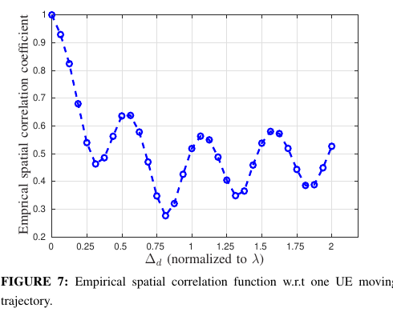
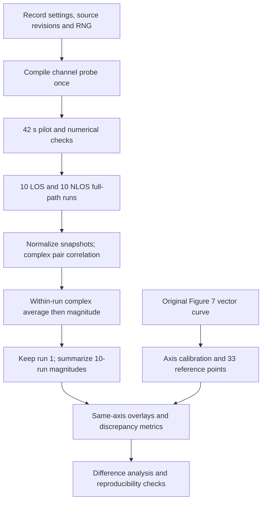
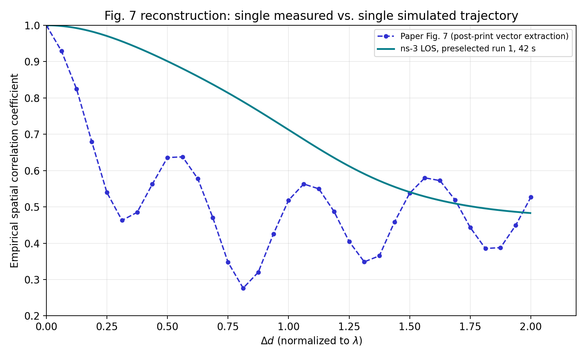
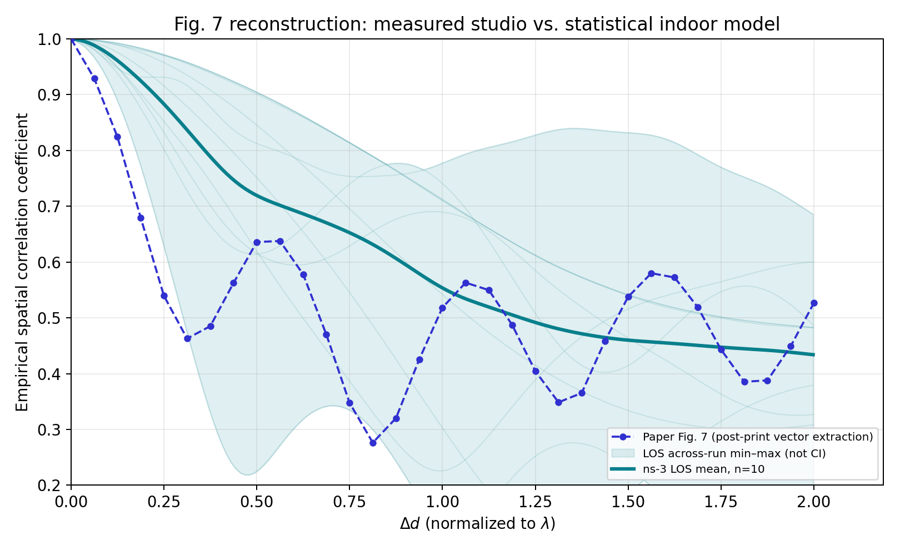
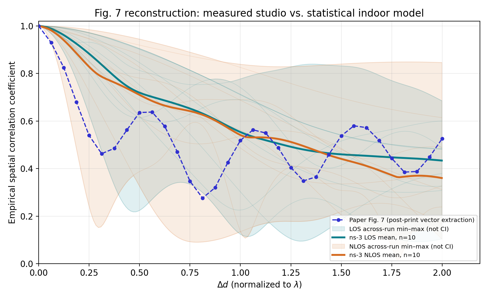

# A4 — Baseline Reproduction: Spatial Channel Correlation

Student: M11502203 Ping-Yu Hsieh

Experiment date: 2026-11-21 (Asia/Taipei)

## 1. Selected Result and Scope

This experiment reconstructs Figure 7, the empirical spatial correlation along one UE trajectory, from G. Tian et al., “Deep-Learning-Based High-Precision Localization With Massive MIMO,” IEEE Transactions on Machine Learning in Communications and Networking, vol. 2, pp. 19–33, 2024. The reference uses uplink indoor channel measurements; this assignment uses an ns-3 statistical indoor channel. The comparison follows the observable in Equation (11), not the paper's neural-network positioning accuracy. [1]

A second observable is now included: [Figure 6 PDP and transfer-function power heatmaps](figure6_study.md), with the formal PDF alongside a stationary approximate position-A simulation. It uses explicit delay-grid and dB conventions; exact measured-map agreement is not claimed.

**Outcome:** 20 full-path baseline simulations completed, the reference curve was recovered, and same-axis comparisons were produced. The simulated curves do not closely match all measured oscillations or the initial decay. This is a documented model-to-measurement discrepancy, not a claim of exact numerical agreement. The experiment provides a channel baseline for the final localization project, not an RF/MLP localization baseline. Instructor acceptance of that scope has not been independently confirmed. A subsequent [40-run observation-noise study and Figure 5 geometry review](noise_study.md) preserves these baseline results and reports the 1/6/11 dB comparisons separately.

## 2. Reference Figure and Observable



Reference data: [33 curve vertices](reference/figure7.csv); [source, SHA-256 and calibration](reference/provenance.json).

The numeric reference comes from the university-hosted accepted manuscript, PDF page 9 / printed page 7. It is explicitly labelled **post-print**, not the publisher PDF. Figure numbering and the equation were cross-checked against the published-author full text; numerical identity between PDF versions was not independently established. The curve was recovered from its blue dashed vector path rather than estimated by eye. This recovers plotted coordinates, not raw measurement data. A conservative coordinate-reporting tolerance is 0.0001 on each axis, not a statistical uncertainty interval.

The original plot shows distance ticks from 0 to 2 wavelengths; its frame extends to approximately 2.1875. Its vertical range is 0.2–1.0. Main overlays preserve those bounds. A supplementary plot uses 0–1.02 so low-valued runs are not hidden.

For each position, flatten the complex antenna-by-frequency response into a vector \(h_i\). With lag \(k\) and \(N-k\) valid pairs:

\[
\rho_k=\frac{1}{N-k}\sum_{i=0}^{N-k-1}
\frac{h_i^Hh_{i+k}}{\|h_i\|_2\|h_{i+k}\|_2},
\qquad r_k=|\rho_k|.
\]

Average **complex correlations first**, then take magnitude. Do not average the magnitudes of individual position-pair correlations. Distance is \(k\times 0.001\) m, normalized by \(\lambda=3\times10^8/(3.7\times10^9)\) m. The simulation reaches 1.998 wavelengths, rather than extrapolating to exactly 2.

## 3. System Model and Parameter Traceability

| Parameter | Paper / traceability | This experiment |
|---|---|---|
| Link direction | Uplink | One single-element UE transmitter to a BS receiver |
| Carrier / nominal bandwidth | 3.7 GHz / 20 MHz | 3.7 GHz; sample the pilot-frequency grid, not a decoded full-band waveform |
| BS array | 100 elements, 4 × 25, approximately half-wavelength spacing | 4 × 25, 0.5λ spacing, single polarization |
| UE height | 1.73 m | 1.73 m |
| Frequency observations | 100 tones; every twelfth subcarrier in an LTE-like grid | 100 tones at 180 kHz spacing, interpreting 12 × 15 kHz; center-to-center span 17.82 MHz |
| Speed / snapshot interval | 0.1 m/s / 10 ms | Same; 1 mm displacement per snapshot |
| Environment | Measured studio | `ThreeGppChannelModel`, `InH-OfficeMixed`; statistical surrogate |
| Primary / sensitivity | Measured channel, not forced simulator states | Forced LOS primary; forced NLOS sensitivity |
| Geometry | Not fully reconstructed | BS (0,0,2.5) m; UE starts (2,2,1.73) m and moves +x |
| Antenna patterns | Measured patch array and UE dipole | `ThreeGppAntennaModel` at BS; isotropic UE approximation |
| Path / duration | Exact first-trajectory endpoints not recovered | Assumed 4.2 m; derived 42 s; 4,201 endpoint-inclusive snapshots |
| Channel update period | Not a simulator setting in the paper | 5 ms; channel evaluated every 10 ms |
| RNG | No simulation RNG list for the measurement | Seed 20261109; runs 1–10 per condition; channel `AssignStreams(1)` |
| Run count | One measured trajectory in the selected figure | 10 LOS + 10 NLOS; one additional LOS pilot repeats run 1 |
| Receiver noise / RF effects | Present in measured observations | Not modelled in the ideal channel probe |
| Traffic / PHY / MAC | Pilot-based channel measurement | No UDP/TCP, scheduling, MCS, HARQ, or standard NR-SRS estimation |

Matched quantities are taken from the paper's measurement description. Geometry, channel family, duration and RNG are explicitly project assumptions, not additional original-paper parameters. A 20 MHz nominal system does not mean all its subcarriers are observed in the 100-tone fingerprint. [1]

Platform: ns-3.48, commit `d2add90b452d600cfb4859baed8e9ea633519447`; GCC 12.3.0; C++23, `-O2`, ns-3 assertions enabled. The complete executed compiler command and configuration are in [configuration.json](results/full/configuration.json). The 5G-LENA scheduler is not required for this channel-only experiment.

### Channel Extraction and Its Limits

The C++ entry point reuses [the A3 channel exporter](../A3/src/channel-spatial-probe.cc). It combines cluster coefficients, delays and ns-3's cluster-centre Doppler convention to construct the frequency response. At the first, middle and last snapshot, it checks the response against ns-3's spectrum conversion with tolerance `1e-9 * max(1, |H|)`. This establishes consistency with the installed implementation, not independent physical validity.

The exporter recomputes delay factors at every snapshot. Its spectrum cross-check invalidates a cached delay-factor key because this ns-3 checkout can update delays without invalidating that cache. No simulator library was modified. The limitation and earlier diagnosis are documented in [A3/environment.md](../A3/environment.md). The source hash is recorded so this reused implementation is identifiable. [2]

## 4. Flowchart and Source Code



Source directory and usage: [src/README.md](src/README.md).

| File | Responsibility |
|---|---|
| [channel-correlation.cc](src/channel-correlation.cc) | Entry point that includes the existing A3 ns-3 implementation |
| [run-experiment.py](src/run-experiment.py) | Build once, execute runs, record configuration, logs and hashes |
| [extract-reference.py](src/extract-reference.py) | Recover reference vertices from the supplied source PDF |
| [analyze.py](src/analyze.py) | Aggregate curves, compare reference points and generate plots |
| [validate.py](src/validate.py) | Check run counts, provenance hashes, repeatability and data dimensions |

The source depends on the existing A3 subtree. Downloading only the one-line C++ entry point is insufficient.

## 5. Numerical Results

### 5.1 Single-Trajectory Reconstruction



The paper's single measured trajectory is compared with **preselected LOS run 1**, not the best-fitting run. Their shapes differ. Correlation-curve RMSE is **0.2670**, calculated at the 32 reference vertices inside the simulated domain, with linear interpolation of the simulated curve. The point at exactly 2λ is excluded from this metric because the simulation ends at 1.998λ. This is dimensionless curve RMSE, not position RMSE in meters.

### 5.2 Multi-Run Summary



Thin lines are individual runs. The bold line averages each run's correlation magnitude; shading is the observed minimum-to-maximum across ten runs, **not a confidence interval**. Sample SD is available in the CSV. Averaging run magnitudes is distinct from averaging complex correlations across different channel realizations.

| Condition | Completed runs | Curve MAE | Curve RMSE | Mean at 1.998λ | Sample SD at 1.998λ |
|---|---:|---:|---:|---:|---:|
| LOS, primary | 10 | 0.1301 | 0.1714 | 0.4339 | 0.1630 |
| NLOS, sensitivity | 10 | 0.1282 | 0.1627 | 0.3605 | 0.2322 |

Both conditions use the same 32-point overlap and interpolation rule. The NLOS metric is descriptive sensitivity evidence, not grounds to replace the predeclared LOS primary experiment after seeing the reference.

| Target separation | Actual simulated separation | Reference, interpolated | LOS mean ± sample SD | NLOS mean ± sample SD |
|---|---:|---:|---:|---:|
| 0.125λ | 0.12333λ | 0.8270 | 0.9620 ± 0.0325 | 0.9410 ± 0.0741 |
| 0.25λ | 0.24667λ | 0.5470 | 0.8856 ± 0.1067 | 0.8312 ± 0.2168 |
| 0.5λ | 0.50567λ | 0.6360 | 0.7174 ± 0.2105 | 0.7075 ± 0.2133 |
| 1λ | 0.99900λ | 0.5169 | 0.5539 ± 0.2433 | 0.5417 ± 0.2460 |
| 1.5λ | 1.50467λ | 0.5408 | 0.4597 ± 0.1844 | 0.4398 ± 0.2022 |
| 2λ | 1.99800λ | 0.5240 | 0.4339 ± 0.1630 | 0.3605 ± 0.2322 |

The table uses the closest simulated lag to each target and interpolates the reference at that actual lag. These are not exact original-paper values at the nominal target positions.

### 5.3 Sensitivity and Full Vertical Range



At 1.998λ, LOS runs span 0.1053–0.6855 and NLOS runs span 0.1046–0.8460. Those low values are clipped in the original-axis overlays but visible here. Ten runs expose substantial realization variability; they do not demonstrate convergence or reproduce the oscillations of one measured trajectory.

Machine-readable results: [summary](results/summary.json), [LOS aggregate](results/los-aggregate.csv), [NLOS aggregate](results/nlos-aggregate.csv), [reference comparisons](results/reference-comparison.csv), [per-run executions](results/full/executions.json). Vector PDFs are available alongside every plot.

## 6. Differences: Evidence Versus Hypotheses

| Observation / mismatch | Interpretation and evidence level |
|---|---|
| Slower early simulated decay | Observed: near 0.247λ, LOS mean is 0.8856 versus reference 0.5470. The mechanism is not uniquely identified. |
| Statistical office model versus measured studio | Confirmed setup difference. Exact scatterer geometry and angular/delay distributions are not reconstructed; these are plausible contributors, not isolated causal results. |
| Ideal channel versus measured radio | Baseline omits noise, RF-chain effects and pilot-estimation error. The [follow-up](noise_study.md) isolates simplified observation noise; RF and pilot-estimation effects remain unmeasured. |
| Oscillatory measured curve versus smoother ensemble mean | A single trajectory and a multi-realization mean are different summaries. The preselected single-run plot avoids relying on that comparison alone. |
| LOS/NLOS sensitivity | Changing the channel condition changes the output distribution. It does not isolate a single parameter such as K-factor. |
| Trajectory length matters | Controlled numerical observation: seed/run 1 has 0.811155 at 1.998λ over the A3 2.56 s prefix, versus 0.483028 over the 42 s path. The first 257 witness records match exactly. Extra position pairs alter the average; the short-path result was not sufficient. |
| Unknown exact first-path geometry and length | Our trajectory is an explicit surrogate. Different geometry and valid-pair populations prevent exact replication of the measurement. |

The baseline model/settings were not optimized against the reference. This experiment does not establish which omitted effect dominates. The [follow-up noise diagnostic](noise_study.md) varies one factor under a documented SNR convention and reports all predeclared conditions without replacing the baseline with the best-looking result. A Figure-5-aligned geometry study remains separate.

The subsequent [trajectory and direction study](geometry_study.md) now reports 30 noiseless runs using the approved approximate Figure 5 geometry, equal-length +x/+y controls, and reversed-data invariance checks. These results are separate from the original baseline and noise experiment; they do not establish the cause of the measured oscillations.

A [small height/bearing screen](sensitivity_study.md) adds twenty full runs and compares five matched runs per setting. Its exploratory results are separate from all previous baseline means; they do not identify the original BS configuration.

## 7. Reproducibility and Verification

From the repository root:

```bash
python3 A4/src/run-experiment.py --runs 1 --conditions los --workers 1 --output A4/results/pilot
python3 A4/src/run-experiment.py --runs 10 --workers 2 --output A4/results/full
python3 A4/src/analyze.py
python3 A4/src/validate.py
```

These output directories already contain the submitted runs. Running into the same paths overwrites them; use another `--output` directory to preserve an earlier simulation. `analyze.py --input NEW_DIRECTORY` can analyze a compatible recorded batch, but writes the aggregate products under `A4/results`.

Reference-recovery commands and the exact download URL are in [src/README.md](src/README.md). The paper PDF remains outside the repository. Runtime dependencies include an already-built ns-3.48, GCC 12, NumPy, Matplotlib and Poppler for reference extraction. The runner selects the system linker rather than the incompatible Homebrew linker discovered during setup.

Verified checks, recorded in [validation.json](results/validation.json):

- 20 successful full runs, each with 4,201 snapshots and 163 lags.
- 60 spectrum-conversion cross-checks, three per full run.
- Finite, nonzero exported channels, moving channel updates, unit zero-lag correlation and magnitudes bounded by one.
- All 20 curve hashes differ across channel realizations.
- The separate pilot and batch LOS run 1 have byte-identical correlation and witness CSVs.
- The original short-path witness is identical to the first 257 full-path records.
- Reference recovery contains 33 vertices; 32 are used in no-extrapolation curve metrics.

The installed official `three-gpp-channel` QUICK suite was also rerun and passed in 8.392 s; see [test log](results/official-channel-test.log). Passing implementation tests does not establish agreement with the measured reference.

Full-run process wall times were approximately 12–21 seconds each with two workers on this machine; this is execution time, not the 42-second simulated duration. Timings are machine/load-dependent. Each worker stores roughly 0.7 GB of channel vectors plus simulator overhead; this is a size estimate, not a measured peak-RSS result.

## 8. Connection to the Final Project

The experiment establishes a repeatable channel observable and reveals discrepancies that must remain visible in the final project. Next, verify cross-path/revisited-position consistency before generating a two-dimensional radio map. Only then compare RF, KNN and a lightweight MLP with identical features and spatial train/test splits. A one-dimensional moving-link check does not prove two-dimensional map consistency or real-world positioning accuracy.

## References

[1] G. Tian, I. Yaman, M. Sandra, X. Cai, L. Liu, and F. Tufvesson, “Deep-Learning-Based High-Precision Localization With Massive MIMO,” IEEE TMLCN, vol. 2, pp. 19–33, 2024, doi: [10.1109/TMLCN.2023.3334712](https://doi.org/10.1109/TMLCN.2023.3334712). [University post-print used for numerical extraction](https://lucris.lub.lu.se/ws/portalfiles/portal/165039395/TMLCN.pdf); [published-author full text](https://www.researchgate.net/publication/376014600_Deep-learning_based_high-precision_localization_with_massive_MIMO).

[2] ns-3.48 source, commit `d2add90b452d600cfb4859baed8e9ea633519447`, `src/spectrum/model/three-gpp-channel-model.cc` and `three-gpp-spectrum-propagation-loss-model.cc`, installed locally under `/home/karl/projects/ns-3.48-nr`. Source revision and export hash are recorded in the experiment configuration.
